# Evidencias de implementación

Capturas de los pasos que ya funcionan, en el orden en que se ejecutan. Cada captura muestra información concreta del resultado (no mensajes de ejecución exitosa). Base para el PDF de evidencias.

Nombre de archivo: `<etapa>_<script>_<número>_<qué-muestra>.png`, en [`capturas/`](capturas/).

## B0 — Infraestructura (`bd/01_infraestructura.sql`)

Ambiente: Docker, PDB `FREEPDB1`, conectado como SYSTEM. Verificado el 2026-10-25.

### 1. Tablespaces en línea con su MAXSIZE

```sql
SELECT t.tablespace_name, t.status, d.bytes / 1024 / 1024 AS tamano_mb,
       d.autoextensible, d.maxbytes / 1024 / 1024 AS maxsize_mb
  FROM dba_tablespaces t
  JOIN dba_data_files d ON d.tablespace_name = t.tablespace_name
 WHERE t.tablespace_name LIKE 'SGS%'
 ORDER BY t.tablespace_name;
```

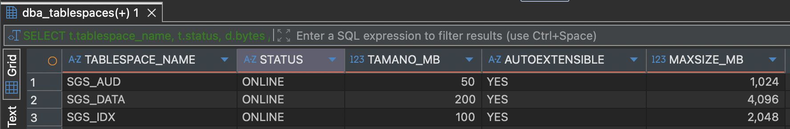

Los 3 tablespaces del proyecto están `ONLINE` y con autoextensión: `SGS_AUD` (50 MB → 1 GB), `SGS_DATA` (200 MB → 4 GB) y `SGS_IDX` (100 MB → 2 GB). El MAXSIZE es finito para que el monitoreo de uso tenga un límite real contra el cual medir.

### 2. Usuario propietario y cuotas

```sql
SELECT u.username, u.account_status, u.default_tablespace, u.temporary_tablespace,
       q.tablespace_name AS tablespace_cuota,
       DECODE(q.max_bytes, -1, 'ILIMITADA', TO_CHAR(q.max_bytes / 1024 / 1024) || ' MB') AS cuota
  FROM dba_users u
  JOIN dba_ts_quotas q ON q.username = u.username
 WHERE u.username = 'SGS_ADMIN'
 ORDER BY q.tablespace_name;
```

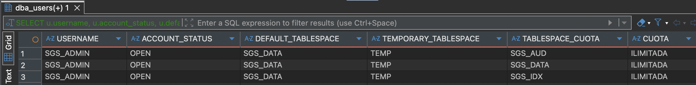

`SGS_ADMIN` está `OPEN`, con `SGS_DATA` como tablespace por defecto, `TEMP` como temporal y cuota ilimitada en los tres tablespaces del proyecto.

### 3. Privilegios de sistema

```sql
SELECT privilege
  FROM dba_sys_privs
 WHERE grantee = 'SGS_ADMIN'
 ORDER BY privilege;
```

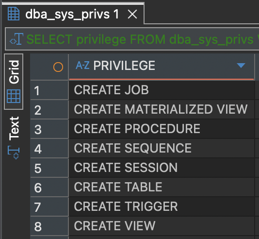

`SGS_ADMIN` tiene solo los 8 privilegios de sistema necesarios para crear y mantener sus objetos.

### 4. Roles otorgados

```sql
SELECT granted_role
  FROM dba_role_privs
 WHERE grantee = 'SGS_ADMIN';
```

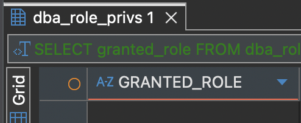

La consulta no devuelve filas: `SGS_ADMIN` no tiene roles, en particular `CONNECT`, `RESOURCE` ni `DBA`.

## B1 — Modelo (`bd/02_modelo.sql`)

Ambiente: Docker, PDB `FREEPDB1`, conectado como `SGS_ADMIN`. Las capturas 1 a 4 son de la instalación desde cero del 2026-10-28 (`00` → `10`), con el modelo definitivo; no cuentan las tablas externas del padrón ni las de las vistas materializadas, que no son tablas del modelo.

### 1. Resumen de objetos del esquema

```sql
SELECT 'Tablas' AS objeto, COUNT(*) AS cantidad FROM user_tables
UNION ALL SELECT 'Secuencias', COUNT(*) FROM user_sequences
UNION ALL SELECT 'Indices', COUNT(*) FROM user_indexes
UNION ALL SELECT 'Vistas', COUNT(*) FROM user_views;
```

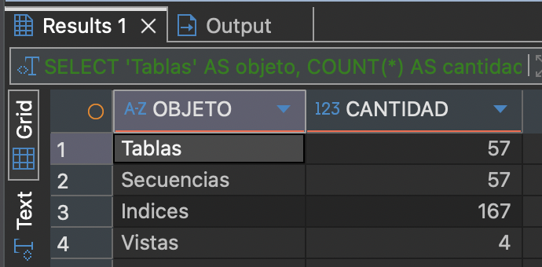

El esquema tiene 57 tablas, cada una con su secuencia (57), 167 índices y 4 vistas (precio de venta, bitácora, bitácora crítica y crecimiento de la base).

### 2. Tablas por tablespace

```sql
SELECT tablespace_name, COUNT(*) AS tablas
  FROM user_tables
 GROUP BY tablespace_name
 ORDER BY tablespace_name;
```

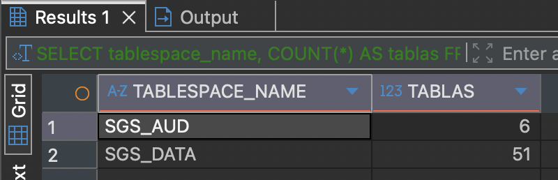

Las 6 tablas de auditoría (histórico de precios, bitácora, detalle de bitácora, bitácora de errores, monitoreo y su detalle por tablespace) están en `SGS_AUD`; las 51 restantes en `SGS_DATA`.

### 3. Índices por tablespace

```sql
SELECT tablespace_name, COUNT(*) AS indices
  FROM user_indexes
 GROUP BY tablespace_name;
```

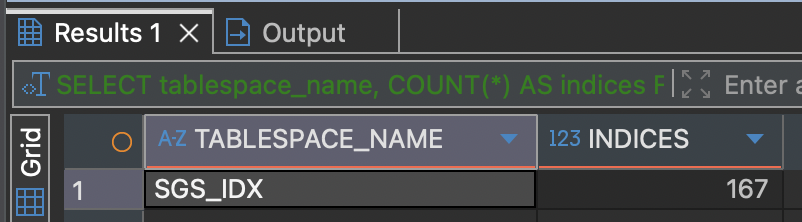

Los 167 índices (llaves primarias, únicas, índices únicos funcionales e índices secundarios) están en `SGS_IDX`, separados de los datos.

### 4. Restricciones de integridad por tipo

```sql
SELECT DECODE(constraint_type, 'P', 'Llave primaria', 'R', 'Llave foranea',
                               'U', 'Unica', 'C', 'Check') AS tipo,
       COUNT(*) AS cantidad
  FROM user_constraints
 WHERE constraint_type IN ('P', 'R', 'U')
    OR (constraint_type = 'C' AND search_condition_vc NOT LIKE '%IS NOT NULL')
 GROUP BY constraint_type
 ORDER BY constraint_type;
```

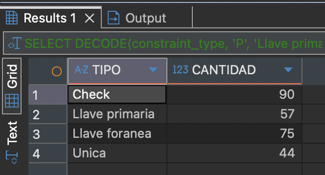

57 llaves primarias, 75 llaves foráneas, 44 restricciones únicas y 90 restricciones CHECK (sin contar los `NOT NULL`).

### 5. Objetos inválidos

```sql
SELECT object_name, object_type, status
  FROM user_objects
 WHERE status <> 'VALID';
```

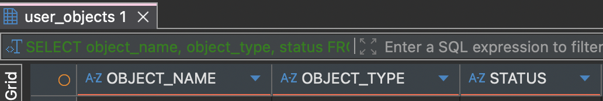

La consulta no devuelve filas: todos los objetos del esquema compilaron correctamente.

### 6. Precio de venta calculado

```sql
SELECT pro_codigo, suc_nombre, pro_precio_costo, ps_pct_utilidad, pct_descuento,
       art_pct_impuesto, precio_sin_impuesto, monto_impuesto, precio_venta
  FROM SGS_VW_PRECIO_VENTA
 WHERE (pro_codigo IN ('LAC-001', 'BEB-001') AND suc_nombre = 'Sucursal San Isidro')
    OR (pro_codigo = 'LIM-001' AND suc_nombre = 'Sucursal Buenos Aires')
 ORDER BY pro_codigo;
```

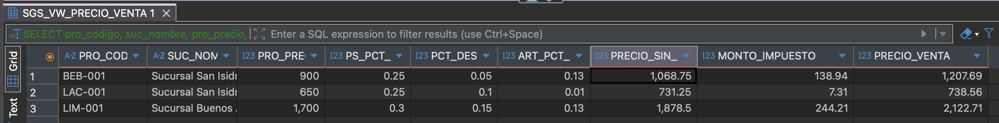

El precio de venta se calcula a partir del costo, la utilidad de la sucursal, el mayor descuento vigente (topado al descuento máximo de la sucursal) y el impuesto del artículo. Ejemplo: el detergente (`LIM-001`) cuesta ₡1.700; con 30 % de utilidad son ₡2.210; el 15 % de descuento de su familia deja ₡1.878,50; con 13 % de impuesto el precio de venta es ₡2.122,71.

## B2 — Base interna (`bd/03_base_interna.sql`)

Ambiente: Docker, PDB `FREEPDB1`, conectado como `SGS_ADMIN`.

### 1. Registro de errores (`SGS_PKG_ERRORES`)

Prueba: un bloque provoca una división entre cero, la captura con `SGS_PKG_ERRORES.registrar` y la vuelve a lanzar con `RAISE` (el bloque termina con el error esperado `ORA-01476`).

```sql
DECLARE
    v_resultado NUMBER;
BEGIN
    v_resultado := 1 / 0;
EXCEPTION
    WHEN OTHERS THEN
        ROLLBACK;
        SGS_PKG_ERRORES.registrar('PRUEBA_B2.division_entre_cero');
        RAISE;
END;

SELECT ber_id, ber_programa, ber_codigo, ber_mensaje, ber_traza, ber_usuario_bd, ber_fecha
  FROM SGS_BITACORA_ERROR
 ORDER BY ber_id;
```

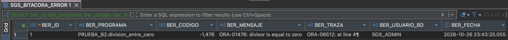

El error quedó registrado con el programa que falló, su código y mensaje, la línea donde ocurrió (traza), la cuenta de Oracle y la fecha. Se registra en una transacción autónoma, por eso queda guardado aunque el bloque que falló haga `ROLLBACK`.

### 2. Parámetros del sistema (`SGS_PKG_PARAMETROS`)

```sql
SELECT par_codigo, par_valor, par_es_cifrado, par_descripcion
  FROM SGS_PARAMETRO
 ORDER BY par_codigo;
```

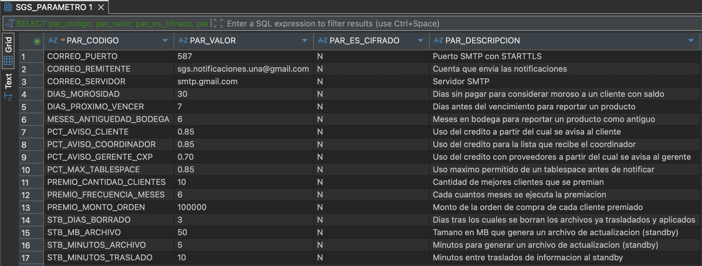

Los valores que el enunciado marca como parametrizados están registrados en `SGS_PARAMETRO`: correo, porcentajes de aviso (como fracción), días, meses, premiación, uso máximo de tablespace y los tiempos del standby. Los packages los leen con `SGS_PKG_PARAMETROS.obtener` y `obtener_numero`; se cambian con `actualizar`, que bloquea la fila con `FOR UPDATE NOWAIT`. Los parámetros cifrados (clave del correo y claves de roles) se agregan con el package de cifrado.

### 3. Destinatarios de las notificaciones

```sql
SELECT des_tipo, des_nombre, des_email, des_estado
  FROM SGS_DESTINATARIO
 ORDER BY des_tipo;
```

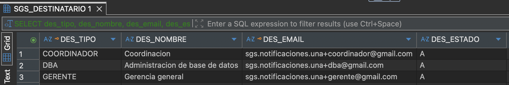

Cada tipo de destinatario (coordinador, DBA, gerente) tiene su correo. En desarrollo son alias de la cuenta del proyecto; antes de la defensa se cambian por el correo externo que indique el profesor.

### 4. Cuerpo del package de cifrado ofuscado (`SGS_PKG_CIFRADO`)

```sql
SELECT line, text
  FROM user_source
 WHERE name = 'SGS_PKG_CIFRADO' AND type = 'PACKAGE BODY'
 ORDER BY line
 FETCH FIRST 5 ROWS ONLY;
```

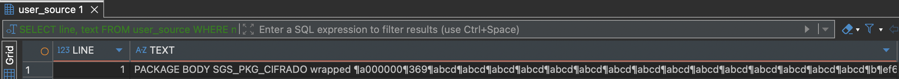

El cuerpo del package se instaló con `DBMS_DDL.CREATE_WRAPPED`: Oracle guarda el código ofuscado (`wrapped`), por lo que la llave de cifrado AES-256 que contiene no se puede leer consultando el código fuente. La llave no está en ninguna tabla.

### 5. Clave del correo cifrada en la tabla de parámetros

```sql
SELECT par_codigo, par_es_cifrado, par_valor
  FROM SGS_PARAMETRO
 WHERE par_es_cifrado = 'S';
```

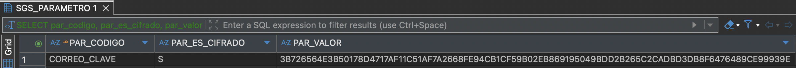

La contraseña de aplicación del correo se guarda cifrada con `DBMS_CRYPTO` (AES-256, CBC, vector inicial aleatorio). En la tabla solo queda el valor cifrado en hexadecimal; el package de correo la descifra con `SGS_PKG_CIFRADO.obtener_parametro` al momento de enviar.

### 6. Validación de contraseñas de los usuarios del sistema

```sql
SELECT SGS_PKG_CIFRADO.validar_usuario('lmora', 'Gerente2026') AS clave_correcta,
       SGS_PKG_CIFRADO.validar_usuario('lmora', 'otraClave')   AS clave_incorrecta,
       SGS_PKG_CIFRADO.validar_usuario('noexiste', 'x')        AS usuario_inexistente
  FROM DUAL;
```

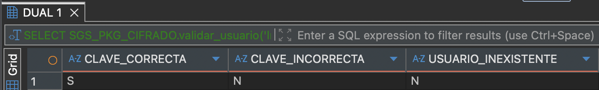

Las contraseñas de los usuarios del sistema se guardan como hash SHA-256 con sal. La validación acepta la clave correcta y rechaza una clave incorrecta y un usuario inexistente.

### 7. Lista de control de red para el correo

```sql
SELECT host, lower_port, upper_port, principal, privilege
  FROM dba_host_aces
 WHERE principal = 'SGS_ADMIN'
 ORDER BY privilege;
```

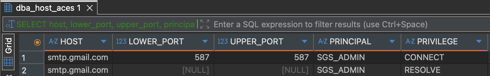

Oracle bloquea toda conexión saliente. La lista de control de red solo autoriza a `SGS_ADMIN` a conectarse a `smtp.gmail.com` (en sus puertos seguros) y a resolver ese nombre. La captura se tomó con el puerto 587; después se agregó el 465, que es el que se usa en la red de desarrollo.

### 8. Correo enviado desde Oracle (`SGS_PKG_CORREO`)

```sql
BEGIN
    SGS_PKG_CORREO.enviar_a_tipo('DBA', 'Prueba SGS: correo enviado desde Oracle',
        'Hola, este correo lo envió Oracle directamente por SMTP sobre TLS, sin VPN.' || CHR(13) || CHR(10)
        || 'Prueba de caracteres: tildes áéíóú, eñe ñ, colones ₡100.000.');
END;
```

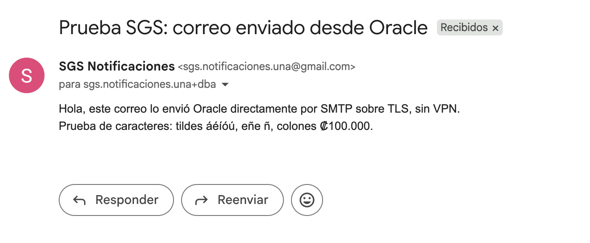

Oracle envía el correo directamente a Gmail por SMTP sobre TLS (puerto 465), sin VPN. El package lee el servidor, el puerto, el wallet y el remitente de `SGS_PARAMETRO`, descifra la clave en el momento del envío y toma el destinatario de `SGS_DESTINATARIO` (tipo DBA). El texto llega en UTF-8, con tildes, eñe y el símbolo de colones.

## B3 — Reglas de negocio (`bd/04_reglas_negocio.sql`)

Ambiente: Docker, PDB `FREEPDB1`, conectado como `SGS_ADMIN`.

### 1. Registro de un cliente nacional desde el padrón (`SGS_PKG_CLIENTES`)

```sql
DECLARE
    v_id NUMBER;
BEGIN
    SGS_PKG_CLIENTES.registrar_nacional(p_cedula => '199990005', p_sexo => 'F', p_estado_civil => 'S',
                                        p_email => 'sgs.notificaciones.una+laura@gmail.com', p_id_cliente => v_id);
    SGS_PKG_CLIENTES.asignar_credito(v_id, 150000);
END;

SELECT c.cli_id, c.cli_cedula, c.cli_nombre, p.clp_apellido1, p.clp_apellido2, p.clp_sexo,
       p.clp_id_padron, c.cli_es_preferencial, x.cxc_limite_credito, x.cxc_saldo
  FROM SGS_CLIENTE c
  JOIN SGS_CLIENTE_PERSONA p ON p.clp_id_cliente = c.cli_id
  JOIN SGS_CUENTA_COBRAR x ON x.cxc_id_cliente = c.cli_id
 WHERE c.cli_cedula = '199990005';
```

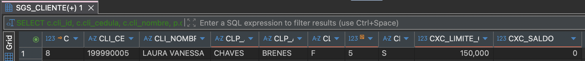

Con solo la cédula, el procedimiento tomó el nombre y los apellidos del padrón y dejó a la clienta enlazada a su persona del padrón. El trigger `TRG_CLI_CREA_CUENTA` le creó la cuenta por cobrar, y `asignar_credito` (que bloquea la cuenta con `FOR UPDATE NOWAIT`) le asignó ₡150.000 de límite y la marcó como preferencial.

### 2. Rechazo: cédula que no está en el padrón

```sql
DECLARE
    v_id NUMBER;
BEGIN
    SGS_PKG_CLIENTES.registrar_nacional(p_cedula => '199990099', p_sexo => 'M', p_id_cliente => v_id);
END;
```

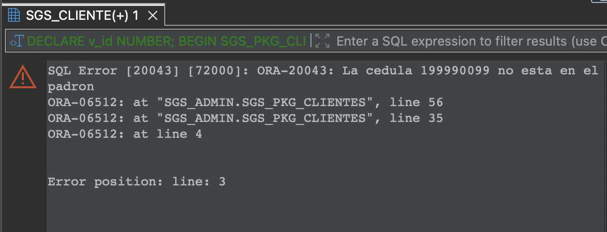

Error esperado: un cliente nacional solo se registra si su cédula existe en el padrón. El procedimiento deshace lo hecho (`ROLLBACK TO SAVEPOINT`), registra el error en la bitácora de errores y lo devuelve con un mensaje claro.

### 3. Rechazo: enlazar a un cliente con otra persona del padrón

```sql
UPDATE SGS_CLIENTE_PERSONA
   SET clp_id_padron = (SELECT pad_id FROM SGS_PADRON WHERE pad_cedula = '199990002')
 WHERE clp_id_cliente = (SELECT cli_id FROM SGS_CLIENTE WHERE cli_cedula = '199990001');
```

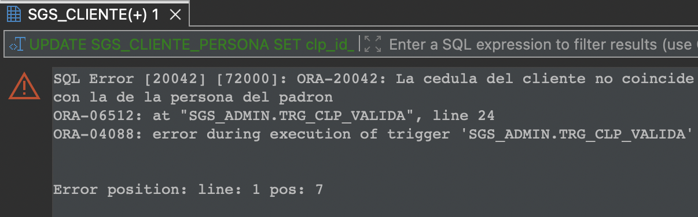

Error esperado: el trigger `TRG_CLP_VALIDA` impide enlazar a un cliente con una persona del padrón que tiene otra cédula. La regla se cumple aunque el cambio se haga con un `UPDATE` directo, sin pasar por el package.

### 4. Rechazo: datos de persona para un cliente empresa

```sql
INSERT INTO SGS_CLIENTE_PERSONA (clp_id, clp_id_cliente, clp_apellido1)
VALUES (SEQ_CLIENTE_PERSONA.NEXTVAL, (SELECT cli_id FROM SGS_CLIENTE WHERE cli_cedula = '3101654321'), 'X');
```

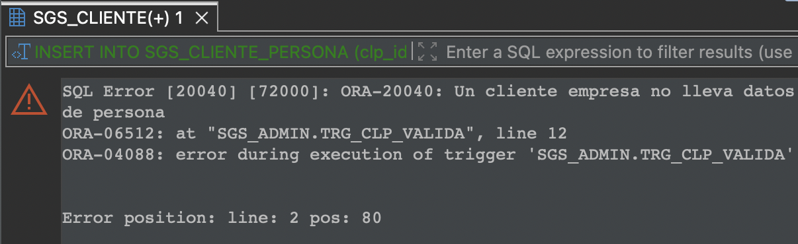

Error esperado: los datos de persona (apellidos, sexo, estado civil, etc.) solo aplican a personas. El trigger `TRG_CLP_VALIDA` protege la relación de subtipo entre `SGS_CLIENTE` y `SGS_CLIENTE_PERSONA`.

### 5. Historial automático de precios de costo

```sql
UPDATE SGS_PRODUCTO SET PRO_PRECIO_COSTO = 1550 WHERE PRO_CODIGO = 'ABA-001';
UPDATE SGS_PRODUCTO SET PRO_PRECIO_COSTO = 1550 WHERE PRO_CODIGO = 'ABA-001';
COMMIT;

SELECT p.pro_codigo, h.hpr_precio_ant, h.hpr_precio_nue, h.hpr_fecha, h.hpr_usuario
  FROM SGS_HISTORICO_PRECIO h
  JOIN SGS_PRODUCTO p ON p.pro_id = h.hpr_id_producto
 WHERE p.pro_codigo = 'ABA-001'
 ORDER BY h.hpr_id;
```

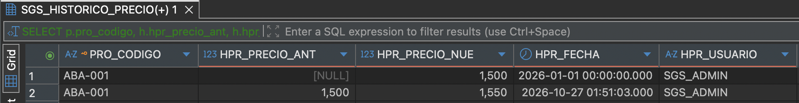

El trigger `TRG_PRO_HISTORICO_PRECIO` registró el cambio de costo del arroz (₡1.500 → ₡1.550) con la cuenta de Oracle y la fecha. El segundo `UPDATE` deja el mismo costo, así que no genera registro. La primera fila es el registro inicial de los datos de catálogo. (La hora sale en UTC porque así está configurado el contenedor de desarrollo.)

### 6. Cuentas por cobrar y por pagar automáticas

Prueba hecha con `INSERT` directos (sin packages), en modo de commit manual y deshecha al final con `ROLLBACK`: los triggers reaccionan aunque nadie use el package.

**Factura a crédito pendiente → saldo del cliente y detalle de la cuenta por cobrar**

```sql
INSERT INTO SGS_FACTURA_VENTA (FV_ID, FV_ID_CLIENTE, FV_ID_SUCURSAL, FV_ID_USUARIO, FV_SUBTOTAL, FV_TOTAL, FV_ES_CREDITO, FV_ESTADO)
VALUES (SEQ_FACTURA_VENTA.NEXTVAL,
        (SELECT CLI_ID FROM SGS_CLIENTE WHERE CLI_CEDULA = '199990001'),
        (SELECT SUC_ID FROM SGS_SUCURSAL WHERE SUC_NOMBRE = 'Sucursal San Isidro'),
        (SELECT USU_ID FROM SGS_USUARIO WHERE USU_USERNAME = 'mcastro'),
        50000, 50000, 'S', 'P');

SELECT f.fv_id, f.fv_total, f.fv_es_credito, f.fv_estado,
       d.dcc_monto_original, d.dcc_saldo, x.cxc_limite_credito, x.cxc_saldo
  FROM SGS_FACTURA_VENTA f
  JOIN SGS_DETALLE_CUENTA_COBRAR d ON d.dcc_id_factura = f.fv_id
  JOIN SGS_CUENTA_COBRAR x ON x.cxc_id = d.dcc_id_cuenta
 WHERE f.fv_id = (SELECT MAX(fv_id) FROM SGS_FACTURA_VENTA);
```

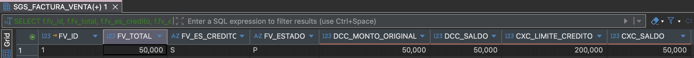

`TRG_FV_CUENTA_COBRAR` agregó la factura al detalle de la cuenta por cobrar y `TRG_DCC_SALDO` aumentó el saldo de la clienta a ₡50.000.

**Pagos → la factura pasa a cancelada**

```sql
INSERT INTO SGS_PAGO_FACTURA_VENTA (PFV_ID, PFV_ID_FACTURA, PFV_ID_TIPO_PAGO, PFV_MONTO)
VALUES (SEQ_PAGO_FACTURA_VENTA.NEXTVAL, (SELECT MAX(FV_ID) FROM SGS_FACTURA_VENTA),
        (SELECT TPA_ID FROM SGS_TIPO_PAGO WHERE TPA_NOMBRE = 'SINPE Movil'), 20000);
INSERT INTO SGS_PAGO_FACTURA_VENTA (PFV_ID, PFV_ID_FACTURA, PFV_ID_TIPO_PAGO, PFV_MONTO)
VALUES (SEQ_PAGO_FACTURA_VENTA.NEXTVAL, (SELECT MAX(FV_ID) FROM SGS_FACTURA_VENTA),
        (SELECT TPA_ID FROM SGS_TIPO_PAGO WHERE TPA_NOMBRE = 'Efectivo'), 30000);
```

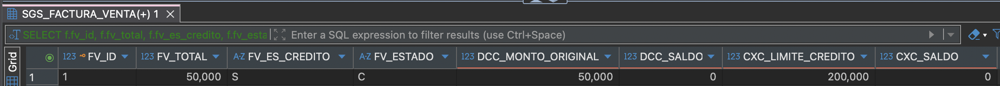

Cada abono bajó el saldo de la factura (`TRG_PFV_ABONO`) y de la cuenta (`TRG_DCC_SALDO`). Al llegar a 0, la factura cambió sola de pendiente (`P`) a cancelada (`C`).

**Rechazo: factura que supera el límite de crédito**

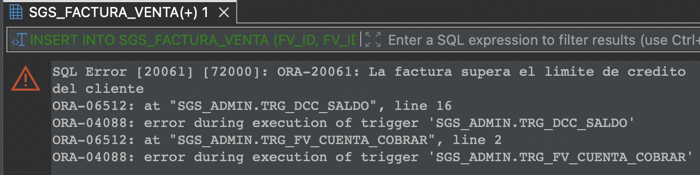

Una factura a crédito de ₡250.000 para una clienta con límite de ₡200.000 se rechaza completa: no se guarda con estado pendiente.

**Rechazo: crédito para un cliente no preferencial**

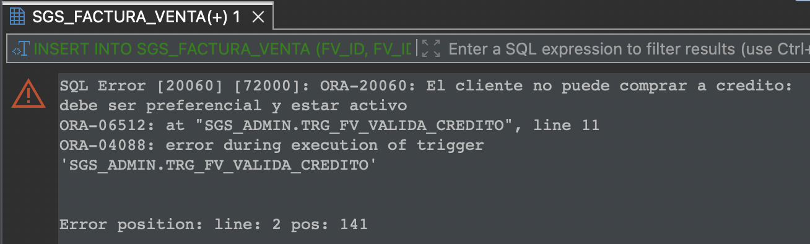

`TRG_FV_VALIDA_CREDITO` solo permite facturar a crédito a clientes preferenciales y activos (nunca al cliente por defecto).

**Rechazo: pago mayor al saldo de la factura**

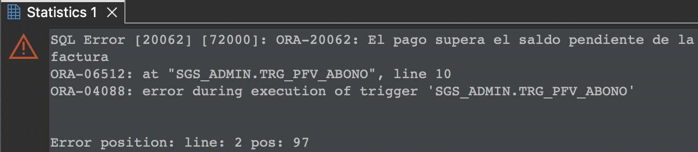

Sobre una factura de ₡10.000, un pago de ₡15.000 se rechaza.

**Factura de proveedor a crédito → cuenta por pagar**

```sql
INSERT INTO SGS_FACTURA_PROVEEDOR (FP_ID, FP_ID_PROVEEDOR, FP_ID_USUARIO, FP_NUMERO, FP_SUBTOTAL, FP_TOTAL, FP_ES_CREDITO, FP_ESTADO)
VALUES (SEQ_FACTURA_PROVEEDOR.NEXTVAL,
        (SELECT PRV_ID FROM SGS_PROVEEDOR WHERE PRV_CEDULA_JURIDICA = '3101100005'),
        (SELECT USU_ID FROM SGS_USUARIO WHERE USU_USERNAME = 'crodriguez'),
        'DAS-0001', 380000, 380000, 'S', 'P');
```

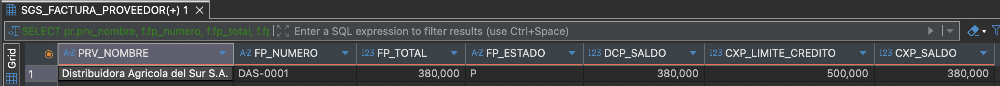

El mismo mecanismo del lado de los proveedores: la factura pendiente aumenta lo que se le debe al proveedor (₡380.000 de ₡500.000).

**Rechazo: factura de proveedor que supera el límite**

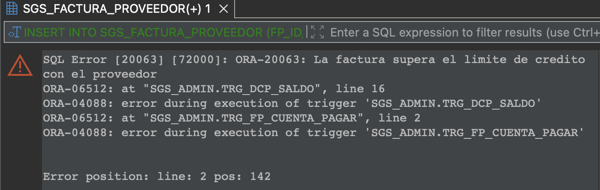

Una segunda compra a crédito de ₡200.000 llevaría la deuda a ₡580.000 y se rechaza.

### 7. Compras (`SGS_PKG_COMPRAS`)

Operaciones completas con el package: una sola transacción con `SAVEPOINT`, bloqueo de la cuenta del proveedor con `FOR UPDATE WAIT 5`, `COMMIT`, y ante error `ROLLBACK TO SAVEPOINT` + bitácora de errores. Los triggers de los pasos anteriores reaccionan a lo que inserta el package.

**Compra a crédito: factura y cuenta por pagar**

```sql
DECLARE
    v_id NUMBER;
BEGIN
    SGS_PKG_COMPRAS.registrar_compra(
        p_proveedor  => '3101100001',
        p_numero     => 'LDV-1001',
        p_usuario    => 'crodriguez',
        p_es_credito => 'S',
        p_lineas     => SGS_PKG_COMPRAS.t_lineas(
                            1 => SGS_PKG_COMPRAS.t_linea(codigo => 'LAC-001', cantidad => 200, costo => 650,  vencimiento => TRUNC(SYSDATE) + 20),
                            2 => SGS_PKG_COMPRAS.t_linea(codigo => 'LAC-002', cantidad => 50,  costo => 2300, vencimiento => TRUNC(SYSDATE) + 55)),
        p_id_factura => v_id);
END;
```

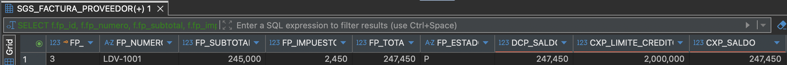

Subtotal ₡245.000 + 1 % de impuesto = ₡247.450, pendiente y cargado a la cuenta por pagar del proveedor.

**Lotes, existencias y movimientos de la compra**

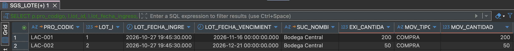

Cada línea creó su lote con fecha de ingreso y de vencimiento, registró el movimiento `COMPRA` en la Bodega Central (el inventario está centralizado) y el trigger `TRG_MOV_EXISTENCIA` subió la existencia.

**Costo distinto → historial de precios**

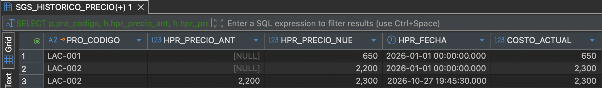

El queso se compró a ₡2.300 (costaba ₡2.200): el package actualizó el costo del producto y el trigger registró el cambio. La leche se compró al mismo costo y no genera registro.

**Compra de contado**

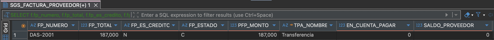

Una compra de contado nace cancelada, con su pago registrado, y no entra a la cuenta por pagar.

**Abono y devolución al proveedor**

```sql
DECLARE
    v_factura NUMBER;
    v_nota    NUMBER;
BEGIN
    SELECT fp_id INTO v_factura FROM SGS_FACTURA_PROVEEDOR WHERE fp_numero = 'LDV-1001';
    SGS_PKG_COMPRAS.registrar_pago(p_id_factura => v_factura, p_monto => 100000, p_tipo_pago => 'Transferencia');
    SGS_PKG_COMPRAS.registrar_devolucion(
        p_id_factura => v_factura,
        p_lineas     => SGS_PKG_COMPRAS.t_lineas_devolucion(
                            1 => SGS_PKG_COMPRAS.t_linea_devolucion(codigo => 'LAC-002', cantidad => 10)),
        p_motivo     => 'Empaque dañado',
        p_usuario    => 'crodriguez',
        p_id_nota    => v_nota);
END;
```

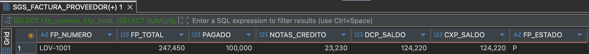

El abono de ₡100.000 y la nota de crédito de ₡23.230 (10 de los 50 quesos) rebajan el saldo a ₡124.220.

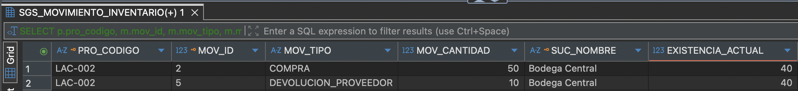

La devolución sale del mismo lote que entró con la compra: el movimiento `DEVOLUCION_PROVEEDOR` bajó la existencia de 50 a 40.

**Rechazos**

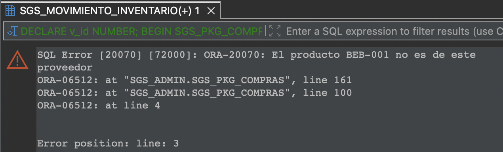

No se le puede comprar a un proveedor un producto que no es suyo.

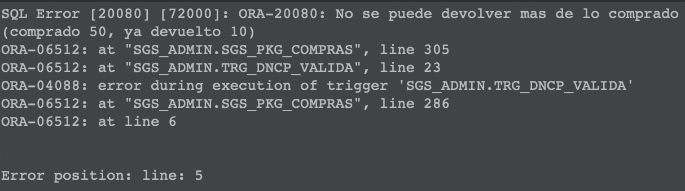

`TRG_DNCP_VALIDA` impide devolver más de lo comprado, sumando todas las notas de crédito de la línea.

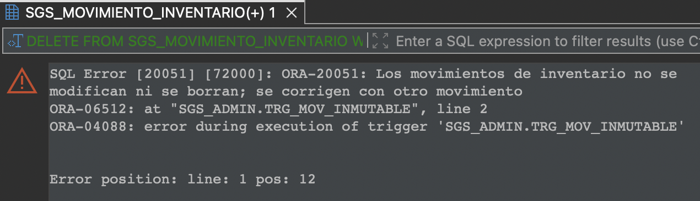

Los movimientos de inventario son la historia del inventario: `TRG_MOV_INMUTABLE` impide modificarlos o borrarlos; un error se corrige con otro movimiento.

### 8. Traslados con selección de lotes por FEFO (`SGS_PKG_INVENTARIO`)

```sql
DECLARE
    v_id NUMBER;
BEGIN
    SGS_PKG_COMPRAS.registrar_compra(p_proveedor => '3101100001', p_numero => 'LDV-1002', p_usuario => 'crodriguez', p_es_credito => 'S',
        p_lineas => SGS_PKG_COMPRAS.t_lineas(1 => SGS_PKG_COMPRAS.t_linea(codigo => 'LAC-001', cantidad => 100, costo => 650, vencimiento => TRUNC(SYSDATE) + 40)),
        p_id_factura => v_id);
    SGS_PKG_INVENTARIO.trasladar('Bodega Central', 'Sucursal San Isidro', 'crodriguez',
        SGS_PKG_INVENTARIO.t_lineas(1 => SGS_PKG_INVENTARIO.t_linea(codigo => 'LAC-001', cantidad => 230),
                                    2 => SGS_PKG_INVENTARIO.t_linea(codigo => 'LAC-002', cantidad => 20),
                                    3 => SGS_PKG_INVENTARIO.t_linea(codigo => 'ABA-001', cantidad => 40),
                                    4 => SGS_PKG_INVENTARIO.t_linea(codigo => 'FRU-001', cantidad => 30)), v_id);
    SGS_PKG_INVENTARIO.trasladar('Bodega Central', 'Sucursal Buenos Aires', 'crodriguez',
        SGS_PKG_INVENTARIO.t_lineas(1 => SGS_PKG_INVENTARIO.t_linea(codigo => 'LAC-001', cantidad => 50),
                                    2 => SGS_PKG_INVENTARIO.t_linea(codigo => 'ABA-001', cantidad => 30)), v_id);
END;
```

**Verificación: existencias por producto y sucursal, y consistencia con los movimientos**

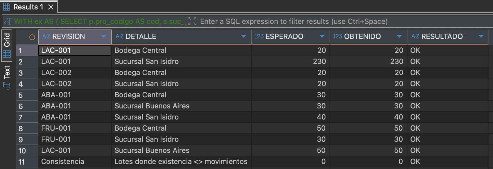

Las existencias de cada producto en la Bodega Central y en las sucursales quedaron como se esperaba, y en ningún lote la existencia difiere de la suma de sus movimientos (entradas menos salidas).

**Reparto de lotes por FEFO**

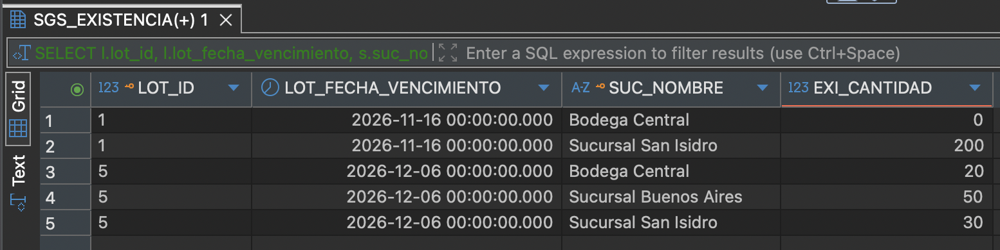

De las 230 leches enviadas a San Isidro, 200 salieron del lote que vence primero (lo dejó en 0 en la central) y 30 del lote siguiente. Los lotes se bloquean con `SELECT … FOR UPDATE WAIT 5` mientras se reparten, para que dos operaciones simultáneas no tomen las mismas unidades.

**Rechazos registrados en la bitácora de errores**

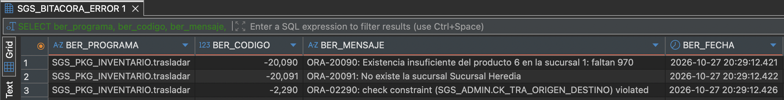

Existencia insuficiente, sucursal inexistente y origen igual al destino (restricción `CK_TRA_ORIGEN_DESTINO`). Cada intento se deshizo con `ROLLBACK TO SAVEPOINT` y quedó registrado por `SGS_PKG_ERRORES`.

### 9. Ventas (`SGS_PKG_VENTAS`)

```sql
DECLARE
    v_f1        NUMBER;
    v_f2        NUMBER;
    v_nota      NUMBER;
    v_sin_pagos SGS_PKG_VENTAS.t_pagos;
BEGIN
    SGS_PKG_VENTAS.registrar_venta(p_sucursal => 'Sucursal San Isidro', p_usuario => 'mcastro', p_cliente => NULL, p_es_credito => 'N',
        p_lineas => SGS_PKG_VENTAS.t_lineas(1 => SGS_PKG_VENTAS.t_linea(codigo => 'LAC-001', cantidad => 5),
                                            2 => SGS_PKG_VENTAS.t_linea(codigo => 'LAC-002', cantidad => 1),
                                            3 => SGS_PKG_VENTAS.t_linea(codigo => 'ABA-001', cantidad => 2),
                                            4 => SGS_PKG_VENTAS.t_linea(codigo => 'Entrega a domicilio', cantidad => 1)),
        p_pagos  => SGS_PKG_VENTAS.t_pagos(1 => SGS_PKG_VENTAS.t_pago(tipo => 'Efectivo', monto => 5000),
                                           2 => SGS_PKG_VENTAS.t_pago(tipo => 'SINPE Movil', monto => 6682.44)),
        p_id_factura => v_f1);
    SGS_PKG_VENTAS.registrar_venta(p_sucursal => 'Sucursal San Isidro', p_usuario => 'mcastro', p_cliente => '199990001', p_es_credito => 'S',
        p_lineas => SGS_PKG_VENTAS.t_lineas(1 => SGS_PKG_VENTAS.t_linea(codigo => 'LAC-001', cantidad => 20),
                                            2 => SGS_PKG_VENTAS.t_linea(codigo => 'FRU-001', cantidad => 10)),
        p_pagos  => v_sin_pagos,
        p_id_factura => v_f2);
    SGS_PKG_VENTAS.registrar_pago(v_f2, 5000, 'SINPE Movil');
    SGS_PKG_VENTAS.registrar_devolucion(v_f2,
        SGS_PKG_VENTAS.t_lineas(1 => SGS_PKG_VENTAS.t_linea(codigo => 'LAC-001', cantidad => 4)),
        'Leche en mal estado', 'mcastro', v_nota);
END;
```

**Verificación: totales, pagos, acciones, saldos e inventario**

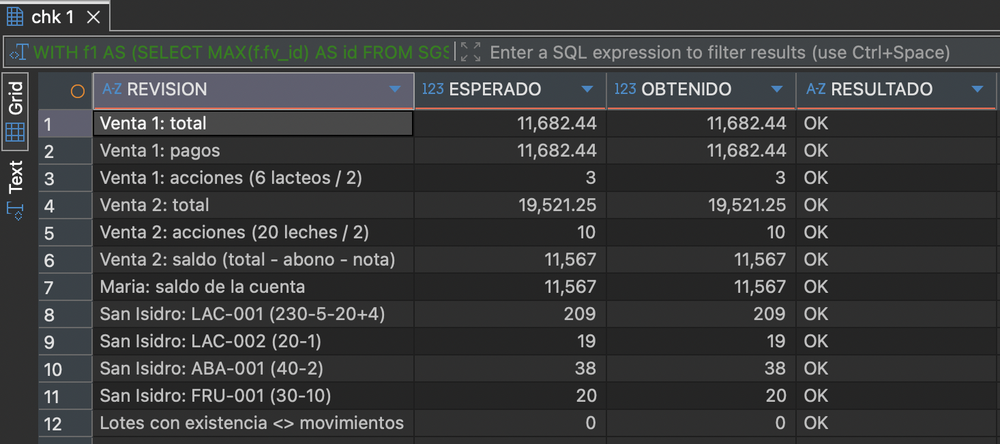

- Venta de contado al cliente por defecto pagada con dos medios (efectivo y SINPE) que suman exactamente el total.
- Venta a crédito a una clienta preferencial: queda pendiente en su cuenta por cobrar; un abono y una nota de crédito (devolución de 4 leches) rebajan el saldo.
- Acciones de la promoción "Lácteos premian" (2 lácteos por acción) calculadas automáticamente al facturar.
- Las ventas descuentan inventario por FEFO desde la sucursal; la devolución regresa la leche al lote del que salió; ningún lote difiere de sus movimientos.

**Detalle de la venta de contado**

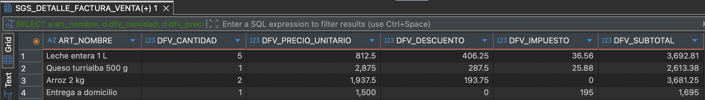

Cada línea toma el precio de la vista de precio de venta (costo + utilidad de la sucursal), aplica el mayor descuento vigente con el tope de la sucursal (10 % a lácteos, 5 % a abarrotes) y el impuesto del artículo (1 % canasta básica, 0 % exento, 13 % el servicio de entrega).

**Rechazos**

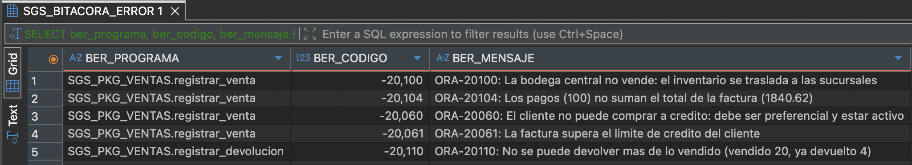

La bodega central no vende, los pagos de contado deben sumar el total, solo los clientes preferenciales compran a crédito, ninguna venta a crédito supera el límite del cliente y no se devuelve más de lo vendido.

### 10. Concurrencia con `SELECT … FOR UPDATE NOWAIT` y `WAIT`

Prueba con dos sesiones de `SGS_ADMIN`. La sesión A bloquea la cuenta por cobrar de una clienta sin terminar su transacción:

```sql
SELECT cxc_id, cxc_saldo
  FROM SGS_CUENTA_COBRAR
 WHERE cxc_id_cliente = (SELECT cli_id FROM SGS_CLIENTE WHERE cli_cedula = '199990001')
   FOR UPDATE;
```

Mientras tanto, la sesión B intenta usar la misma cuenta dos veces: cambiar el límite (`SGS_PKG_CLIENTES.asignar_credito`, que bloquea con `NOWAIT`) y registrar un abono (`SGS_PKG_VENTAS.registrar_pago`, que bloquea con `WAIT 5`).

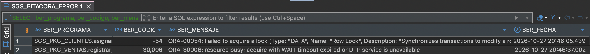

La bitácora registra el error original de Oracle de cada caso: con `NOWAIT` el rechazo es inmediato (`ORA-00054`); con `WAIT 5` la sesión espera 5 segundos y luego se rinde (`ORA-30006`). Al usuario el package le devuelve un mensaje claro ("la cuenta la está usando otra sesión; intente de nuevo").

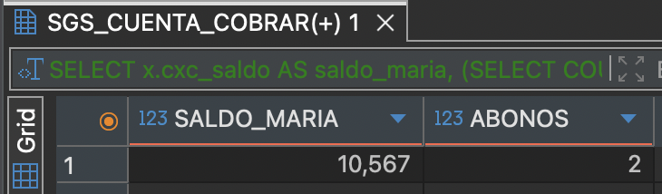

Cuando la sesión A termina (`ROLLBACK`), el mismo abono en la sesión B pasa de inmediato: el saldo baja a ₡10.567 y la clienta tiene 2 abonos.

## Datos de operaciones (`bd/10_datos_operaciones.sql`)

Las compras, pagos, devoluciones, traslados y ventas de prueba se cargan **con los packages**, igual que una operación real, para que los triggers mantengan saldos, existencias, movimientos e historial. La sección C del script "envejece" algunos registros de prueba (un pago de hace 45 días, un lote con 7 meses en bodega, un lote vencido) para poder demostrar los procesos automáticos.

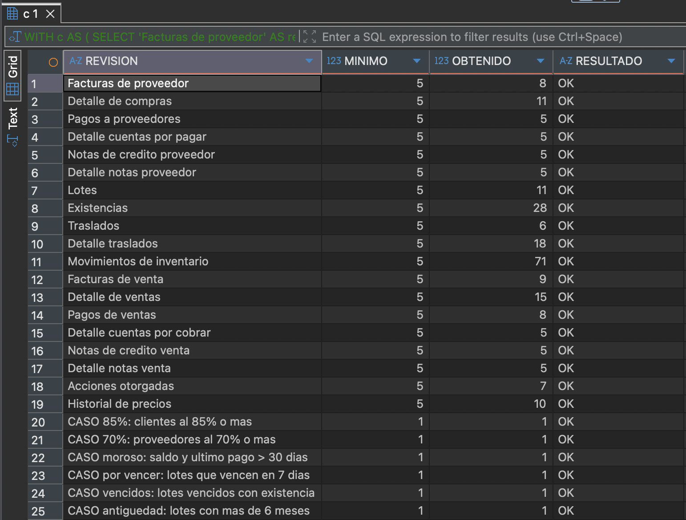

Todas las tablas de operaciones tienen 5 o más registros (requisito del E1), y quedan listos los casos que disparan los procesos y notificaciones: una clienta al 86 % de su crédito, un proveedor al 71 %, un cliente moroso, un lote por vencer en la semana, un lote vencido con existencia y un lote con más de 6 meses en bodega.

# B4 — Bitácoras de auditoría (`bd/05_bitacoras.sql`)

Cada operación sobre las tablas de facturación, precios, inventario, clientes, proveedores, promociones y descuentos deja un encabezado en `SGS_BITACORA` (área, tabla, operación, registro, usuario de base de datos y del sistema operativo, equipo, fecha y si es crítica) y una fila en `SGS_BITACORA_DETALLE` por cada columna que cambió, con su valor anterior y nuevo.

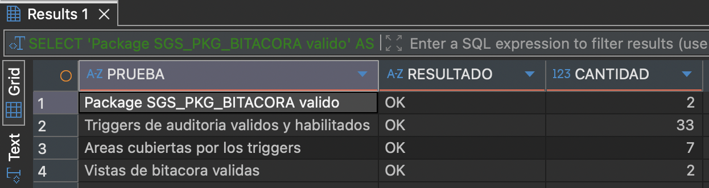

El package `SGS_PKG_BITACORA` (especificación y cuerpo), los 33 triggers de auditoría (uno por tabla auditada, todos válidos y habilitados), las 7 áreas cubiertas y las vistas `SGS_VW_BITACORA` y `SGS_VW_BITACORA_CRITICA`.

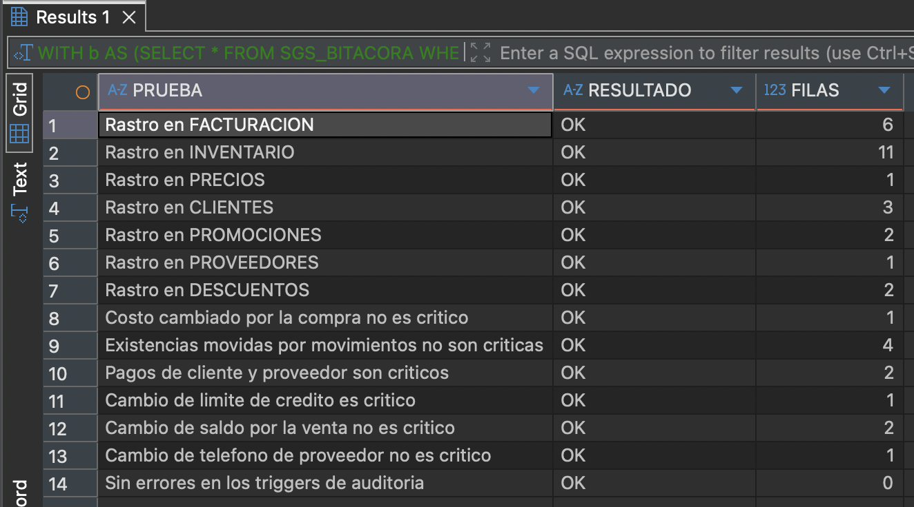

Después de una operación normal en cada área (compra de contado con costo nuevo, traslado, aumento de crédito, venta a crédito con abono, cambio de teléfono de un proveedor, cambio de descripción de una promoción y un descuento nuevo), las 7 áreas tienen rastro. Se marcan como críticos los pagos y el cambio de límite de crédito. No son críticos el costo actualizado por la compra, las existencias movidas por los movimientos de inventario, el saldo que sube con la venta ni el teléfono del proveedor. Los triggers de auditoría no registraron errores.


Seis operaciones hechas a mano, sin pasar por los packages, quedan marcadas como críticas junto a las de la prueba anterior (los dos pagos y el aumento de límite): una factura anulada (`P` → `N`), el costo del arroz cambiado sin una compra, una existencia ajustada sin movimiento de inventario, un proveedor inactivado, una promoción con condiciones cambiadas y el borrado de un enlace de descuento. Cada operación muestra solo las columnas que cambiaron con su valor anterior y nuevo; el borrado guarda los valores que tenía el registro.


Después de `ROLLBACK`, las seis operaciones a mano desaparecen de la bitácora y quedan solo las confirmadas: la auditoría va en la misma transacción que el cambio, así que nunca muestra un cambio que no ocurrió.

# B5 — Padrón nacional (`bd/06_padron.sql`)

El padrón se carga desde los archivos oficiales del TSE (`PADRON_COMPLETO.txt` y `distelec.txt`), copiados a una carpeta del servidor.


Los dos archivos del TSE en la carpeta del servidor de desarrollo, con dueño `oracle` para que la base los pueda leer.


El objeto directorio `SGS_DIR_PADRON` apunta a esa carpeta; SGS_ADMIN tiene lectura (los archivos) y escritura (los `.log` y `.bad` de cada lectura).


Las tablas externas leen los archivos sin cargarlos: las 2179 líneas de distritos (incluida la que trae una coma en el nombre), las 3 762 240 personas con cédula válida, y los nombres con Ñ convertidos correctamente de Latin-1 a la base.


`SGS_PKG_PADRON.cargar` dejó los 2179 distritos electorales y las 3 762 240 personas del TSE, más las 8 personas de prueba, que se conservan porque la carga nunca borra. Los 5 clientes nacionales siguen enlazados a su persona del padrón y la carga no registró errores.


Al volver a cargar el mismo archivo no se inserta ni se actualiza nada: el `MERGE` solo toca a las personas nuevas o con datos distintos. La carga se puede repetir cada vez que el TSE publique un padrón nuevo sin duplicar datos ni reescribir millones de filas que llegarían a la standby como redo.

# B6 — Procesos programados y notificaciones (`bd/07_procesos.sql`)

Cada proceso es un procedimiento de `SGS_PKG_PROCESOS` ejecutado por un job de `DBMS_SCHEDULER`; también se puede correr a demanda. Los correos se envían con `SGS_PKG_CORREO` a los destinatarios configurados.

## Aviso al cliente al 85 % de su límite


Los clientes con crédito y el porcentaje que usan de su límite. Solo Laura (86,4 %) supera el umbral del parámetro `PCT_AVISO_CLIENTE` (85 %) y debe recibir el aviso.


El job `SGS_JOB_AVISO_CLIENTES` está habilitado y programado todos los días a las 07:00 en hora de Costa Rica; la próxima ejecución la calcula el scheduler en esa zona aunque el servidor esté en UTC.


Al correr el job a demanda, Laura recibe en su correo el aviso con el porcentaje usado, su límite, su saldo y lo disponible, con montos en colones.


El scheduler registra la ejecución del job como exitosa, con su hora de inicio en Costa Rica y su duración.

## Lista al coordinador de los clientes al 85 %


El coordinador recibe un solo correo con todos los clientes que deben el 85 % o más de su límite (parámetro `PCT_AVISO_COORDINADOR`): porcentaje usado, saldo, límite y correo de cada uno, más el total de clientes y la suma de sus saldos.

## Proveedores al 70 % de su límite


El gerente recibe un solo correo: primero los proveedores a los que se les debe el 70 % o más de su propio límite (parámetro `PCT_AVISO_GERENTE_CXP`), con lo disponible, y después el estado de todos los proveedores con crédito y el total adeudado.

## Clientes morosos


Los clientes con saldo y los días desde su último abono a una factura a crédito (o desde su factura pendiente más vieja si nunca abonaron). Solo José supera los 30 días del parámetro `DIAS_MOROSIDAD`.


Un solo correo, dirigido a la vez al gerente y al coordinador, con cada moroso, su saldo, sus facturas pendientes, su último pago y los días sin pagar, más el total de morosos y lo que deben.

## Productos vencidos


Los lotes con fecha de vencimiento pasada que todavía tienen existencia: el banano del lote 11 en la Bodega Central, 40 unidades a ₡400 de costo.


El coordinador recibe la lista de lotes vencidos con su sucursal, fecha de vencimiento, cantidad y costo, y el total en lotes, unidades y valor al costo para decidir qué hacer con ellos.

## Procesos de negocio programados


Los 9 jobs de `DBMS_SCHEDULER` habilitados, con su frecuencia y su próxima ejecución en hora de Costa Rica: los 5 avisos diarios a las 07:00, el cierre diario a las 00:05, la inclusión de descuentos y el reporte de inventario los lunes a las 06:00 y 07:00, y la premiación cada `PREMIO_FRECUENCIA_MESES` meses (6) el día 1 a las 08:00.


Los 4 procesos corridos a demanda terminaron bien: la carne próxima a vencer y el detergente antiguo quedaron incluidos en sus descuentos, la premiación generó 6 órdenes de compra, el cierre del día cuadra (total = vendido − devuelto, y la suma por cajero coincide con el cierre) y no hubo errores.


El coordinador recibe, por separado, los lotes que vencen en los próximos 7 días y los lotes con más de 6 meses en inventario, con la sucursal y la cantidad de cada uno.


Los clientes con más compras netas del período reciben una orden de compra por el monto del parámetro `PREMIO_MONTO_ORDEN` (₡100.000); el coordinador recibe la lista ordenada y el total en órdenes.


El gerente y el coordinador reciben el cierre del día: facturas y monto vendido, devoluciones y monto devuelto, total del día y el detalle por cajero.

# B7 — Seguridad (`bd/08_seguridad.sql`)

Un usuario de Oracle por rol (Gerente, Jefe Departamento, Jefe Proveeduría, Digitador), con un perfil de contraseñas y un rol protegido con clave. La clave de cada rol está cifrada en la tabla de parámetros y se activa con un procedimiento.


El perfil `SGS_PERFIL_USUARIO`: 3 intentos fallidos, bloqueo automático de 30 minutos (0,0208 días), contraseña de 60 días con 7 de gracia, sin reutilizar las últimas 5 ni las de los últimos 365 días, 2 sesiones simultáneas y 15 minutos de inactividad.


Los 4 usuarios abiertos, con el perfil y la clave que expira en 60 días. Cada uno tiene su rol, pero no activo al conectarse. Su único privilegio de sistema es `CREATE SESSION`; sus únicos privilegios de objeto directos son `EXECUTE` sobre los packages que activan el rol.


Los 4 roles están protegidos con contraseña y solo tienen privilegios de objeto (0 de sistema): consultas, inserciones y actualizaciones según su función, `EXECUTE` sobre los packages de su área y ningún `DELETE`.


Las claves de los 4 roles guardadas cifradas (AES-256) en `SGS_PARAMETRO`; el valor almacenado no es la clave legible.


Cada usuario intenta las mismas acciones. Sin activar su rol, Oracle rechaza todo; tampoco puede activar el rol de otro (`ORA-20132`). Al activar su rol con `SGS_PKG_ACCESO.activar_rol`, que lee la clave cifrada, puede hacer solo lo de su función: el digitador vende, el jefe de departamento además administra descuentos, el jefe de proveeduría compra y modifica proveedores, y el gerente consulta las operaciones críticas, asigna crédito y ejecuta procesos. Ninguno puede borrar.


Tres intentos con clave incorrecta (`ORA-01017`) y al cuarto la cuenta queda bloqueada (`ORA-28000`).


El perfil impide volver a usar la misma contraseña (`ORA-28007`).

# B8 — Monitoreo y complementos (`bd/09_monitoreo.sql`)

El package `SGS_PKG_MONITOREO` revisa a diario los tablespaces, los objetos inválidos y los índices del proyecto, avisa de sesiones bloqueadas cada 15 minutos y guarda un registro diario del estado de la base. Además se crearon las dos vistas materializadas y se analizaron los planes de ejecución.


El package válido, los 6 jobs de monitoreo habilitados, las dos vistas materializadas con datos, el parámetro nuevo `MINUTOS_SESION_BLOQUEADA` y la columna de errores en `SGS_MONITOREO`, sin objetos inválidos en el esquema.


Los 15 jobs de `DBMS_SCHEDULER` del sistema, todos habilitados, con su frecuencia y su próxima ejecución en hora de Costa Rica.


El reporte diario al DBA: tamaño de la base y crecimiento desde la revisión anterior, sesiones, objetos inválidos, índices dañados, errores de las últimas 24 horas, uso de cada tablespace y los programas con más errores.


Cada revisión queda guardada en `SGS_MONITOREO` y `SGS_MONITOREO_TABLESPACE`; la vista `SGS_VW_CRECIMIENTO` calcula el crecimiento entre una revisión y la anterior.


Con el umbral bajado a propósito, la revisión de tablespaces avisa al DBA cuáles superan el porcentaje permitido y sugiere la acción.


Un procedimiento de prueba creado con un error queda inválido y la revisión diaria lo reporta.


Un índice de prueba marcado como `UNUSABLE` se reporta con la sentencia para reconstruirlo. Al terminar las tres pruebas, el umbral vuelve a 85 % y el procedimiento y el índice de prueba se borran.


Dos sesiones modifican el mismo registro: la segunda queda esperando (`enq: TX - row lock contention`) y el monitoreo avisa al DBA cuál sesión espera y cuál la bloquea.


La vista materializada de ventas mensuales: facturas, monto vendido, devuelto y neto por mes y sucursal.


La vista materializada de inventario consolidado: existencia, valor al costo, cantidad de lotes y primer vencimiento de cada producto en cada sucursal.


Costo, índices usados y recorridos completos de las consultas analizadas con `EXPLAIN PLAN` (conclusiones en `docs/optimizacion.md`).


En el padrón de 3,7 millones de personas, buscar por cédula usa el índice único y cuesta 3; buscar por nombre recorre la tabla completa y cuesta 8 453.

# Historial de los procesos (`bd/10_datos_operaciones.sql`, sección D)

Para que las tablas que llenan los procesos también tengan 5 registros o más con datos coherentes, se cargaron ventas de servicios de semestres anteriores (no mueven inventario) y se ejecutaron los procesos con su fecha: premiaciones con fecha de corte, cierres de días anteriores, la inclusión semanal de descuentos y revisiones de monitoreo.


Las 57 tablas del modelo tienen 5 registros o más (la consulta pone primero las que no cumplan; no hay ninguna).


Cinco premiaciones semestrales, cada una con los clientes que más compraron en su período y su orden de compra de ₡100.000.


Cinco cierres diarios: el de la venta a crédito de José, tres días sin ventas (el cierre se hace igual) y el día de las ventas de prueba con sus cuatro cajeros.

# Instalación desde cero

El sistema completo se reinstaló en el Docker con los scripts oficiales, en orden (`00` a `10`), con un script de terminal que pone las claves del ambiente, ejecuta cada parte con SQL*Plus y el usuario que corresponde (SYS o SGS_ADMIN) y se detiene ante cualquier error o problema de compilación.


Las 16 partes de la instalación terminaron sin errores en 1 minuto 27 segundos, incluida la carga de los 3,7 millones de personas del padrón.


Después de instalar: 57 tablas, todas con 5 registros o más; 16 packages válidos; 50 triggers; 4 vistas y 2 vistas materializadas; ningún objeto inválido; 15 jobs programados; el padrón completo; la clave del correo y las de los 4 roles cifradas; 5 premiaciones y 5 cierres; y la bitácora con las operaciones auditadas.


Los datos de prueba incluyen seis operaciones que el sistema debe rechazar; cada rechazo queda en la bitácora de errores con el programa que lo detectó y su mensaje: venta a crédito sobre el límite, traslado sin existencia suficiente, cédula fuera del padrón, proveedor inexistente, límite de crédito menor a la deuda y venta en la bodega central.
