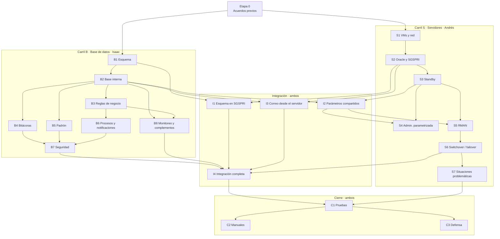

# Guía de implementación — Entregable #2 (SGS)

Guía de trabajo para Isaac y Andrés. Ordena **qué se hace, en qué orden y por qué**, conecta cada etapa con los requerimientos del enunciado y con la rúbrica, y marca las dependencias entre los dos carriles.

> **Qué NO es esta guía:** no explica *cómo* se implementa cada cosa (código, comandos). Eso se define al llegar a cada etapa, con lo que realmente se necesite en ese momento.
>
> **Es una guía viva:** cuando se tome una decisión o algo cambie, se actualiza aquí y se anota en [`docs/decisiones.md`](docs/decisiones.md).

---

## Contenido

- [Cómo usar esta guía](#cómo-usar-esta-guía)
- [Mapa de dependencias](#mapa-de-dependencias)
- [Etapa 0 — Acuerdos previos](#etapa-0--acuerdos-previos)
- [Criterios transversales](#criterios-transversales)
- [Carril B — Base de datos (Isaac)](#carril-b--base-de-datos-isaac)
- [Carril S — Servidores (Andrés)](#carril-s--servidores-andrés)
- [Puntos de integración](#puntos-de-integración)
- [Cierre](#cierre)
- [Documentación a entregar](#documentación-a-entregar)
- [Matriz de trazabilidad](#matriz-de-trazabilidad)
- [Pendientes de confirmar con el profesor](#pendientes-de-confirmar-con-el-profesor)

---

## Cómo usar esta guía

- **B** = carril de base de datos (Isaac) · **S** = carril de servidores (Andrés) · **I** = integración (ambos) · **C** = cierre (ambos).
- Cada etapa tiene siempre los mismos campos:

| Campo | Para qué sirve |
|---|---|
| **Objetivo** | Qué se logra al terminar |
| **Depende de** | Qué tiene que estar listo antes de empezar |
| **Definir antes de empezar** | Decisiones que se toman primero |
| **Implementaciones** | Lo que se hace en la etapa (casillas para marcar avance) |
| **Cuidados** | Riesgos y detalles a no olvidar |
| **Terminado cuando…** | Cómo se sabe que de verdad está lista |
| **Desbloquea** | Qué etapas se pueden empezar después |
| **Cumple** | Códigos de requerimientos del enunciado (ver [matriz](#matriz-de-trazabilidad)) |
| **Rúbrica** | Rubros de la nota que atiende |
| **Aporta a** | A qué documento final alimenta |

- Para marcar avance: cambiar `- [ ]` por `- [x]` y hacer commit.
- Una etapa solo se marca como terminada cuando se cumple todo su **"Terminado cuando…"** y los [criterios transversales](#criterios-transversales).

---

## Mapa de dependencias

**Lectura rápida:**
- Isaac y Andrés arrancan en paralelo después de la Etapa 0 (B1 y S1).
- Los carriles se cruzan en **I1** (el esquema llega al servidor), **I2** (el standby lee los parámetros de la base) e **I3** (el correo sale desde el servidor).
- Todo converge en **I4**, y de ahí al cierre.

---

## Etapa 0 — Acuerdos previos

**Responsables:** ambos · **Depende de:** nada · **Desbloquea:** B1, S1

### Decisiones tomadas

| Elemento | Valor |
|---|---|
| Usuario dueño del esquema | `SGS_ADMIN` |
| Pluggable database | `SGSPDB` |
| Servidor principal (`DB_UNIQUE_NAME`) | `SGSPRI` |
| Servidor standby (`DB_UNIQUE_NAME`) | `SGSSTB` |
| Prefijo de objetos | `SGS_` |
| Arquitectura | 2 VMs (Oracle Linux + Oracle 21c EE) en la HP; Mac de Isaac como cliente con DBeaver (validado con el profesor) |
| Dónde vive la documentación de trabajo | Este repositorio |

### Por cerrar

- [x] Repositorio creado, ambos con acceso y README en la raíz.
- [x] **Lista de parámetros confirmada** (nombres y valores iniciales). En especial los que usa Andrés: tiempo máximo entre redo (5 min), tamaño de redo (50 MB), frecuencia de traslado (10 min), días antes de borrar (3), hora del respaldo diario.
- [x] Cuenta de correo del proyecto creada (remitente de las notificaciones).
- [ ] Preguntas al profesor enviadas (ver [pendientes](#pendientes-de-confirmar-con-el-profesor)).

**Terminado cuando…** todo lo anterior está anotado en `docs/decisiones.md`.

---

## Criterios transversales

Aplican a **todas** las etapas que produzcan código. Una etapa no está terminada si no los cumple.

| Código | Criterio |
|---|---|
| RB1 | La lógica vive en **packages** organizados por módulo (procedimientos y/o funciones) |
| RB2 | Las operaciones críticas manejan **commit, rollback y savepoint** |
| RB3 | Cada procedimiento y función tiene **manejo de excepciones** y registra los errores en la bitácora de errores |
| RB5 | Todo proceso automático usa **`DBMS_SCHEDULER`** (nada con cron ni con el programador de tareas del sistema) |
| RB10 | Ningún valor marcado como "parametrizado" está escrito en el código: se lee de la tabla de parámetros |
| RB12 | Las reglas que no se pueden hacer con restricciones SQL van en **packages o triggers** |
| NG4 | El código tiene **documentación interna** (comentarios simples) |
| — | El script corre **desde cero** sin errores y es compatible con **Oracle 21c** (cuidado con sintaxis exclusiva de 23ai si se desarrolla en Oracle Free) |
| — | Lo que funciona se sube al repo y su paso de instalación queda anotado para el manual |

---

## Carril B — Base de datos (Isaac)

Entorno de desarrollo: Oracle Free en Docker (Mac). Entorno oficial: `SGSPRI` (ver [I1](#i1--esquema-en-sgspri)).

### B1 — Esquema

**Objetivo:** un modelo corregido, reforzado y completo, con **todas** las estructuras que van a necesitar las etapas siguientes, listo para construir encima.

**Depende de:** Etapa 0

**Definir antes de empezar:**
- Qué piezas del esquema de Andrés (`CADENA_NEGOCIOS`) se integran y cómo se traducen a la convención SGS.
- Dónde vive el saldo de clientes y proveedores (en la cuenta por cobrar/pagar, en el cliente/proveedor, o ambos con su justificación).
- Códigos de los atributos de dominio corto (estados, sexo, estado civil, tipo de persona, etc.).
- Estrategia de bitácoras: una bitácora general con valores anterior/nuevo, o una tabla de auditoría por área.
- Cómo se enlaza el padrón con los clientes (relación opcional: extranjeros y empresas no están en el padrón).
- Cómo se modelan los lotes (separados de la existencia y ligados a la compra).

✅ Las 6 definiciones quedaron cerradas el 2026-10-26 (decisiones 1 a 6 de B1 en [`docs/decisiones.md`](docs/decisiones.md)).

**Implementaciones:**

*a) Correcciones del profesor al E1*
- [x] Tabla de países; nacionalidad y residencia del cliente pasan a referenciarla.
- [x] Ningún `CLOB`: pasar a `VARCHAR2(250)`.
- [x] Todos los estados como `VARCHAR2(1)` con `CHECK` de valores permitidos.
- [x] Género como `VARCHAR2(1)` con `CHECK`; mismo criterio para otros atributos codificados.
- [x] Usuario dueño `SGS_ADMIN` con privilegios explícitos (sin `CONNECT`, `RESOURCE` ni `DBA`).

*b) Integración de lo fuerte del esquema de Andrés*
- [x] Cuentas por cobrar y por pagar con sus abonos y estado.
- [x] Condición (contado/crédito) y estado en las facturas de venta y de proveedor.
- [x] Lote separado de la existencia, ligado al detalle de compra y con fecha de vencimiento.
- [x] Descuento con días desde ingreso / días para vencer y su validación por tipo de criterio.

*c) Estructuras nuevas que pide el E2*
- [x] Tabla de parámetros (incluye espacio para claves cifradas de roles y correo).
- [x] Configuración de correo y destinatarios de notificaciones (gerente, coordinador, DBA).
- [x] Bitácora de errores.
- [x] Bitácoras de auditoría de las 7 áreas (según la estrategia decidida).
- [x] Movimientos de inventario.
- [x] Tipos de promoción y acciones otorgadas por factura.
- [x] Detalle de productos incluidos en un descuento.
- [x] Padrón nacional y su enlace con clientes.
- [x] Cierre diario (encabezado) y su detalle por cajero.
- [x] Órdenes de compra para clientes premiados.

*d) Lo que acompaña al modelo*
- [x] Tablespaces, secuencias, índices (incluidos los que necesitarán las consultas de los requerimientos), comentarios y datos de prueba.
- [x] Datos de prueba pensados para demostrar los requerimientos (clientes cerca del 85 %, productos por vencer, lotes antiguos, morosos, etc.). *Catálogos en B1; operaciones después de B3, cargadas con los packages (ver `docs/decisiones.md`).*
- [x] Diagrama relacional actualizado.
- [x] Diccionario de datos actualizado (`docs/modelo/SGS_diccionario_datos.docx`, generado del catálogo de SGSPRI).

**Cuidados:**
- El modelo **se recalifica**: la normalización y las convenciones siguen contando.
- Todo lo que pidan B2–B8 en estructura debe quedar aquí; agregar tablas después obliga a rehacer diagrama y diccionario.
- Las rutas de datafiles deben seguir siendo dinámicas (sirven en ambos servidores).

**Terminado cuando…**
- El script crea todo desde cero sin errores, en la PDB, como `SGS_ADMIN`.
- El diagrama y el diccionario coinciden con lo que crea el script.
- Cada tabla nueva está justificada por un requerimiento.

**Desbloquea:** B2, I1 · **Cumple:** NG5, F04 (modelo), F10 (tipos), N6 (tablas), parte de RB6 (privilegios del dueño) · **Rúbrica:** modelo relacional (se recalifica), integración del padrón y adaptación del modelo · **Aporta a:** diagrama, diccionario, manual de instalación

---

### B2 — Base interna

**Objetivo:** las piezas internas que usan todos los demás procesos: parámetros, errores, cifrado y correo.

**Depende de:** B1

**Definir antes de empezar:**
- Proveedor de correo (Gmail u otro) y cómo se autentica desde Oracle.
- Qué datos se cifran (clave del correo, claves de roles, otras configuraciones).

**Implementaciones:**
- [x] Package de parámetros: leer y actualizar valores de forma centralizada.
- [x] Package de errores: registrar en la bitácora de errores desde cualquier procedimiento.
- [x] Package de cifrado con `DBMS_CRYPTO`: cifrar y descifrar datos sensibles.
- [x] Package de correo: enviar un correo leyendo remitente, clave (descifrada), servidor y destinatarios desde parámetros.
- [x] Prueba real: llega un correo a una bandeja externa.

**Cuidados:**
- **El correo es lo de mayor riesgo técnico del carril B**: probarlo lo antes posible.
- El envío debe ser directo desde Oracle, **sin VPN**.
- La clave del correo nunca queda en texto plano, ni en la base ni en el repo.

**Terminado cuando…** un procedimiento cualquiera puede leer un parámetro, registrar un error y enviar un correo, y la clave del correo solo existe cifrada.

**Desbloquea:** B3, B4, B5, B8, I2, I3 · **Cumple:** F14, F15 (en desarrollo), RB7, RB10 · **Rúbrica:** proc/func almacenadas, bitácora de errores · **Aporta a:** manual técnico, manual de instalación

---

### B3 — Reglas de negocio

**Objetivo:** que la base reaccione sola a facturas, pagos, compras y devoluciones.

**Depende de:** B2

**Definir antes de empezar:**
- Cómo afectan las notas de crédito al saldo y al estado de la factura.
- Criterio para elegir de qué lote se descuenta en una venta (por ejemplo, el que vence primero).
- Qué cuenta como "producto con precio de costo diferente" (compra con costo distinto, cambio directo, o ambos).

✅ Las 4 definiciones (incluida la arquitectura packages + triggers) quedaron cerradas el 2026-10-26; ver `docs/decisiones.md`.

**Implementaciones:**
- [x] Factura de venta pendiente → sube el saldo del cliente y entra a cuentas por cobrar.
- [x] Factura de proveedor pendiente → sube el saldo adeudado y entra a cuentas por pagar.
- [x] Validación de límites de crédito (clientes y proveedores): si se supera, no se guarda como pendiente.
- [x] Pagos/abonos → bajan el saldo; si se cancela completo, la factura pasa a cancelada.
- [x] Compras → crean lote y suben el inventario.
- [x] Ventas → bajan el inventario.
- [x] Devoluciones (de cliente y a proveedor) → ajustan el inventario.
- [x] Cada movimiento de inventario queda registrado.
- [x] Cambio de precio de costo → historial de precios.
- [x] Promociones → cálculo automático de acciones según productos patrocinadores.
- [x] Concurrencia con `SELECT FOR UPDATE` (`NOWAIT`/`WAIT`) al aplicar pagos y descontar existencias.

**Cuidados:**
- Varias reglas se disparan con la misma operación: definir bien el orden y que todo ocurra en una sola transacción.
- Probar también los casos que deben **fallar** (límite excedido, inventario insuficiente).

**Terminado cuando…** cada regla se demuestra con una operación en DBeaver y una consulta que muestra el efecto, incluidos los casos rechazados.

**Desbloquea:** B6, B8 · **Cumple:** F01, F02, F03, F05, F06, F07, F08, F10 (cálculo), RB11 · **Rúbrica:** proc/func, transacciones y excepciones, triggers, funcionalidad del negocio (CxC, CxP, estado, inventario, historial, límites, promociones) · **Aporta a:** manual técnico, documentación del código

---

### B4 — Bitácoras de auditoría

**Objetivo:** registro automático de cambios en las áreas principales.

**Depende de:** B2

**Implementaciones:**
- [x] Triggers de auditoría para: facturación, cambio de precios, movimientos de inventario, clientes, proveedores, promociones, descuentos.
- [x] Cada registro guarda quién, cuándo, qué operación y valores anterior/nuevo.
- [x] Auditoría de operaciones críticas (pagos, anulaciones, cambios de límites, etc.).

**Cuidados:** las bitácoras van en el tablespace de auditoría; no deben bloquear la operación si el registro falla.

**Terminado cuando…** una operación en cada una de las 7 áreas deja su rastro consultable.

**Desbloquea:** B7 · **Cumple:** F13, RB4 · **Rúbrica:** auditoría – bitácoras (bitácora de cambios, auditoría de operaciones críticas), triggers · **Aporta a:** manual técnico

---

### B5 — Padrón nacional

**Objetivo:** el padrón cargado y enlazado con los clientes.

**Depende de:** B2 (y el modelo de B1)

**Definir antes de empezar:** fuente y formato del padrón vigente, y cómo se "carga automáticamente" (desde archivo, programado o a demanda).

**Implementaciones:**
- [x] Procedimiento de carga automática del padrón con registro de errores.
- [x] Enlace cliente ↔ padrón para obtener los datos básicos de la persona.
- [x] Ubicación del archivo en el servidor acordada con Andrés (`/opt/oracle/oradata/padron` en las dos VMs).

**Cuidados:**
- Es una carga de millones de registros: tamaño del tablespace y tiempo de carga.
- En el standby: la carga debe generar redo (sin operaciones sin registro), si no, la standby queda inconsistente. Coordinar con S7.

**Terminado cuando…** el padrón está cargado completo y un cliente nacional muestra sus datos desde el padrón.

**Desbloquea:** B7 · **Cumple:** F04 (carga) · **Rúbrica:** integración del padrón nacional (6 %) · **Aporta a:** manual de instalación, manual técnico

---

### B6 — Procesos programados y notificaciones

**Objetivo:** los procesos automáticos de negocio y sus correos.

**Depende de:** B3 (y B2 para el correo)

**Implementaciones:**
- [x] Semanal: productos por vencer y productos con más de 6 meses en bodega → coordinador.
- [x] Semanal: descuentos planeados → incluir productos al detalle del descuento.
- [x] Semestral: top 10 clientes → orden de compra → coordinador.
- [x] Diario: cierre diario (totales y detalle por cajero) → coordinador y gerente.
- [x] Clientes al 85 % de su límite → correo al propio cliente.
- [x] Lista del 85 % → coordinador (clientes, cuentas por cobrar).
- [x] Cuentas por pagar al 70 % → **un solo correo** al gerente con todos los proveedores.
- [x] Morosos (saldo pendiente y último pago con más de un mes) → gerente y coordinador.
- [x] Productos vencidos con total → coordinador.
- [x] Cada proceso se puede ejecutar **a demanda** para la revisión.

**Cuidados:** frecuencias y umbrales desde parámetros; los correos agrupados también se evalúan ("notificaciones agrupadas correctamente").

**Terminado cuando…** cada job existe en el scheduler, corre a demanda y el correo llega con el contenido correcto.

**Desbloquea:** B7 · **Cumple:** F09, F11, F12, N1–N6 · **Rúbrica:** automatizaciones (scheduler), automatización (vencer, antigüedad, cierre, procesos programados), notificaciones, descuentos programados, clientes premiados · **Aporta a:** manual técnico (documentación de jobs), manual de instalación

---

### B7 — Seguridad

**Objetivo:** acceso controlado por perfiles, roles y usuarios.

**Depende de:** B4, B5, B6 (los objetos sobre los que se dan permisos ya existen)

**Definir antes de empezar:** qué puede hacer cada rol (Gerente, Jefe Departamento, Jefe Proveeduría, Digitador) y qué usuarios de prueba se crean.

**Implementaciones:**
- [x] Perfiles de contraseña: expiración, intentos fallidos, bloqueo automático, reutilización.
- [x] Roles mínimos con solo los privilegios necesarios (sin `DBA`, `CONNECT`, `RESOURCE`).
- [x] Distinción clara entre privilegios de sistema y de objeto.
- [x] Roles protegidos con clave; claves cifradas en la tabla de parámetros.
- [x] Procedimientos que activan los roles con su clave.
- [x] Usuarios de prueba por rol.

**Cuidados:** activar roles con clave desde un procedimiento tiene restricciones en Oracle; probarlo temprano dentro de la etapa.

**Terminado cuando…** cada rol puede hacer exactamente lo suyo y nada más, y los perfiles bloquean y expiran como se configuró.

**Desbloquea:** I4 · **Cumple:** SEG1, SEG2, RB6 · **Rúbrica:** seguridad (usuarios, roles, privilegios), contraseñas, admin. de privilegios · **Aporta a:** manual técnico

---

### B8 — Monitoreo y complementos

**Objetivo:** vigilancia de la base y los requisitos técnicos restantes.

**Depende de:** B2 (correo) y B3 (datos para las vistas y consultas)

**Implementaciones:**
- [x] Package de monitoreo: crecimiento de la base, uso de tablespaces, sesiones y errores.
- [x] Diario: tablespaces por encima del 85 % → notificar.
- [x] Diario: objetos inválidos → notificar.
- [x] Diario: índices dañados → notificar.
- [x] Vista materializada de ventas mensuales.
- [x] Vista materializada de inventario consolidado.
- [x] `EXPLAIN PLAN` sobre las consultas de los requerimientos (costos e índices usados), con conclusiones.

**Terminado cuando…** las revisiones diarias notifican al provocar el problema a propósito, y las vistas se refrescan solas.

**Desbloquea:** I4 · **Cumple:** N7, N8, N9, RB8, RB9, RB13 · **Rúbrica:** monitoreo (tablespaces, objetos inválidos, índices, sesiones) · **Aporta a:** manual técnico

---

## Carril S — Servidores (Andrés)

Todo paso que funcione se anota de inmediato (con capturas) para el manual de instalación y el del standby.

### S1 — VMs y red

**Objetivo:** dos servidores Linux listos y comunicados.

**Depende de:** Etapa 0

**Definir antes de empezar:** recursos por VM (RAM, CPU, disco) según la HP; IPs fijas de la red interna; nombres de host.

**Implementaciones:**
- [x] VM `SGSPRI` y VM `SGSSTB` con Oracle Linux, mismos recursos en ambas.
- [x] Red interna con IPs fijas entre las VMs + salida a internet.
- [x] Nombres de host resolubles entre ellas.
- [x] Tailscale en ambas VMs (sin exit node) para que el Mac llegue a ellas.

**Cuidados:** la sincronización principal ↔ standby va por la red interna, **no** por Tailscale.

**Terminado cuando…** las VMs se ven entre sí por la red interna, tienen internet y el Mac llega a ambas.

**Desbloquea:** S2 · **Cumple:** SB1 (parte) · **Rúbrica:** implementación y configuración del standby · **Aporta a:** manual de instalación

---

### S2 — Oracle y SGSPRI

**Objetivo:** Oracle 21c EE instalado en ambos servidores y la base principal creada.

**Depende de:** S1

**Implementaciones:**
- [x] Oracle 21c Enterprise Edition instalado en ambas VMs, con rutas idénticas.
- [x] Base principal (CDB) con la PDB `SGSPDB`.
- [x] La standby queda solo con el software (sin crear base).
- [x] Conexión desde DBeaver en el Mac hacia `SGSPDB`.

**Terminado cuando…** el Mac se conecta a `SGSPDB` y la VM standby tiene el software listo.

**Desbloquea:** S3, I1, I3 · **Cumple:** SB1, SB4 · **Rúbrica:** implementación y configuración del standby · **Aporta a:** manual de instalación

---

### S3 — Standby

**Objetivo:** `SGSSTB` como copia sincronizada de `SGSPRI`.

**Depende de:** S2

**Implementaciones:**
- [x] Principal preparada (archivado, registro forzado, flashback, área de recuperación, parámetros de Data Guard).
- [x] Duplicación de la principal hacia la standby.
- [x] Aplicación continua de cambios en la standby.
- [x] Prueba: un dato insertado en la principal aparece en la standby.

**Cuidados:** como es 21c, la PDB también tiene que quedar disponible en la standby.

**Terminado cuando…** un cambio en `SGSPRI` aparece en `SGSSTB` y las consultas de estado muestran la sincronización.

**Desbloquea:** S4 (vía I2), S5, I2 · **Cumple:** RB14 (sincronización) · **Rúbrica:** implementación y configuración del standby (20 %) · **Aporta a:** manual de instalación, manual del standby

---

### S4 — Administración parametrizada del standby

**Objetivo:** que el standby se administre solo, con los valores de la tabla de parámetros.

**Depende de:** S3, I2

**Implementaciones:**
- [x] Archivo de actualización cada 5 minutos o 50 MB (parametrizado), sin intervención del DBA.
- [x] Traslado a la standby cada 10 minutos (parametrizado).
- [x] Traslado **a demanda** para la revisión.
- [x] Borrado de archivos ya trasladados (principal) y ya aplicados (standby) con más de 3 días (parametrizado).
- [x] Todo con `DBMS_SCHEDULER`.

**Cuidados:** nunca borrar archivos que la standby aún no aplicó.

**Terminado cuando…** cambiar un valor en la tabla de parámetros cambia el comportamiento sin tocar código.

**Desbloquea:** I4 · **Cumple:** SB2, SB3, SB5 · **Rúbrica:** administración, sincronización y monitoreo del standby · **Aporta a:** manual del standby

---

### S5 — Respaldos con RMAN

**Objetivo:** estrategia de respaldo y recuperación completa.

**Depende de:** S3, I2

**Implementaciones:**
- [x] Backup full.
- [x] Backup incremental.
- [x] Respaldo diario automático (`DBMS_SCHEDULER`) copiado al standby.
- [x] Respaldo **a demanda** para la revisión.
- [x] Práctica de restore y recovery (por ejemplo, pérdida simulada de un archivo).

**Terminado cuando…** existe un respaldo diario en ambos servidores y una recuperación probada de punta a punta.

**Desbloquea:** S6 · **Cumple:** SB6, RB15 · **Rúbrica:** estrategia de respaldo y recuperación (RMAN) · **Aporta a:** manual del standby, manual técnico

---

### S6 — Switchover, failover y recuperación

**Objetivo:** demostrar que el sistema sobrevive a mantenimientos y caídas.

**Depende de:** S5

**Implementaciones:**
- [x] Switchover (intercambio planeado de roles) y regreso.
- [x] Failover (caída simulada de la principal).
- [x] Reincorporación del servidor caído como nueva standby.
- [x] Monitoreo de la sincronización (retraso, archivos recibidos/aplicados). (`SHOW DATABASE` del broker y `servidores/operacion_diaria.md`)
- [x] Procedimiento de cómo reconectar el cliente al nuevo principal. (`servidores/s6_switchover_failover.md` §2: DBeaver apunta a la IP de Tailscale de la nueva principal)

**Terminado cuando…** cada escenario se ejecutó al menos una vez de punta a punta siguiendo los pasos anotados.

**Desbloquea:** S7, I4 · **Cumple:** RB14 · **Rúbrica:** procedimientos de recuperación, failover y switchover; administración y monitoreo del standby · **Aporta a:** manual del standby

---

### S7 — Situaciones problemáticas

**Objetivo:** saber qué acciones en la principal causan problemas en la standby y cómo resolverlas.

**Depende de:** S6

**Implementaciones:**
- [ ] Identificar casos (operaciones sin registro, nuevos tablespaces/datafiles, reinicio de la standby, archivos faltantes, etc.).
- [ ] Probar al menos los más probables, incluida la carga del padrón (coordinar con B5).
- [ ] Documentar síntoma, causa y solución de cada uno.

**Terminado cuando…** cada caso tiene su solución probada y escrita.

**Desbloquea:** C1 · **Cumple:** NG2 · **Rúbrica:** manual de administración del standby · **Aporta a:** manual del standby

---

## Puntos de integración

### I1 — Esquema en SGSPRI

**Depende de:** B1, S2 · **Qué se hace:** ejecutar los scripts de B1 en `SGSPDB` del servidor oficial.

- [x] Script de infraestructura y modelo ejecutado en `SGSPRI` sin errores (los 01 a 10 completos, 2026-10-28).
- [x] Diferencias entre Oracle Free y 21c identificadas y corregidas (los scripts corrieron en 21c sin cambios).

**Regla:** a partir de aquí, cada etapa del carril B que se termina se ejecuta también en `SGSPRI`. No se deja la integración para el final.

### I2 — Parámetros compartidos

**Depende de:** B2, S3 · **Desbloquea:** S4, S5

- [x] Los parámetros del standby y del respaldo existen en la tabla de parámetros con los nombres acordados (`STB_*` y `RESP_HORA_DIARIO`, instalados en `SGSPRI`).
- [x] Los procesos de Andrés leen esos valores.

### I3 — Correo desde el servidor

**Depende de:** B2, S2

- [x] Configuración de red y seguridad del correo hecha en `SGSPRI` (wallet y puerto 465 en las dos VMs).
- [x] Un correo enviado desde `SGSPRI` llega a una bandeja externa, sin pasar por VPN.

### I4 — Integración completa

**Depende de:** B7, B8, S6, I1, I3

- [x] Todo el carril B corre en `SGSPRI`.
- [x] El standby replica todo, incluidos los objetos y datos nuevos.
- [x] Los jobs funcionan en la principal y, después de un switchover, en la nueva principal (probado 2026-10-29 con los 19 jobs, el correo, una compra y el padrón).

---

## Cierre

### C1 — Pruebas de punta a punta

**Depende de:** I4, S7

- [ ] Recorrido completo en el orden de la defensa, sobre los servidores reales.
- [ ] Verificación de cada fila de la [matriz de trazabilidad](#matriz-de-trazabilidad).
- [ ] Prueba del manual de instalación siguiendo sus pasos, al menos en una parte, para confirmar que es 100 % funcional.

### C2 — Manuales

**Depende de:** C1

- [ ] Documentación interna del código revisada.
- [ ] Manual de instalación y despliegue.
- [ ] Manual de administración del standby.
- [ ] Manual técnico de administración y mantenimiento.
- [x] Diagrama relacional y diccionario finales (`docs/modelo/`).

### C3 — Defensa

**Depende de:** C1

- [ ] Correo externo del profesor configurado en parámetros antes de iniciar.
- [ ] Guion de demostración (qué se muestra, en qué orden, quién lo presenta).
- [ ] Cada uno explica la parte del otro (pueden preguntarle de todo a ambos).
- [ ] Ensayo completo con la HP y el Mac.
- [ ] Plan B de conexión si la red de la universidad falla (Tailscale o hotspot).

---

## Documentación a entregar

| Documento | Rúbrica | Qué contiene | Aportan |
|---|---|---|---|
| Documentación del código | 3 % | Comentarios en scripts, packages, triggers y scripts de Linux/RMAN | Ambos, en cada etapa |
| Manual de instalación y despliegue | 3 % | Paso a paso de toda la implementación, solución dada a cada requerimiento, conceptos y cómo usarlos, documentación de los jobs | Ambos |
| Manual de administración del standby | 2 % | Operación diaria, sincronización, monitoreo, respaldos, switchover/failover, cómo actuar ante situaciones problemáticas | Andrés |
| Manual técnico de administración y mantenimiento | 2 % | Parámetros, jobs y su ejecución a demanda, usuarios y roles, alertas de monitoreo, bitácoras, resultados de `EXPLAIN PLAN` | Isaac (principalmente) |
| Diagrama y diccionario actualizados | (modelo recalificado) | Modelo final completo | Isaac |

> Si la implementación falla, **el manual también se penaliza**: solo se documentan pasos confirmados.

---

## Matriz de trazabilidad

Estado: ⬜ pendiente · 🟨 en progreso · ✅ listo. La columna «Dónde se demuestra» apunta a la sección de [`docs/evidencias/evidencias.md`](docs/evidencias/evidencias.md) (o al documento de `servidores/`) con la prueba; es la lista de control para C1 y la defensa.

### Funcionalidades

| Código | Requerimiento | Etapa | Rúbrica | Dónde se demuestra | Estado |
|---|---|---|---|---|---|
| F01 | Cuentas por cobrar automáticas | B3 | Act. automática de CxC (4 %) | B3 §6 | ✅ |
| F02 | Cuentas por pagar automáticas | B3 | Act. automática de CxP (4 %) | B3 §6 y §7 | ✅ |
| F03 | Cambio automático de estado de factura | B3 | Cambio automático del estado (3 %) | B3 §6 (factura cancelada) | ✅ |
| F04 | Padrón nacional y adaptación del modelo | B1 + B5 | Integración del padrón (6 %) | B3 §1 a §4, B5; carga desde SGSSTB en el switchover | ✅ |
| F05 | Inventario automático en compras y ventas | B3 | Act. automática del inventario (5 %) | B3 §7 a §9 | ✅ |
| F06 | Inventario automático en devoluciones | B3 | Act. automática del inventario (5 %) | B3 §7 (devolución al proveedor) y §9 (nota de crédito de venta) | ✅ |
| F07 | Historial automático de precios | B3 | Historial de precios (3 %) | B3 §5 | ✅ |
| F08 | Límites al facturar como pendiente | B3 | Validación de límites de crédito (4 %) | B3 §6 (rechazo sobre el límite); rechazos esperados de la instalación | ✅ |
| F09 | Semanal: por vencer y más de 6 meses | B6 | Próximos a vencer (3 %), antigüedad (3 %) | B6, procesos de negocio programados | ✅ |
| F10 | Tipos de promoción y acciones automáticas | B1 + B3 | Admin. automática de promociones (4 %) | B3 §9 (acciones calculadas al facturar) | ✅ |
| F11 | Descuentos planeados semanales | B6 | Admin. de descuentos programados (3 %) | B6, procesos de negocio programados | ✅ |
| F12 | Top 10 clientes y orden de compra | B6 | Clientes premiados (4 %) | B6 e historial de los procesos (premiaciones) | ✅ |
| F13 | Bitácoras de las 7 áreas | B4 | Bitácora de cambios (4 %) | B4; pruebas en 21c (`I4_01`) | ✅ |
| F14 | Notificaciones parametrizadas, clave cifrada | B2 | Notificaciones / cifrado | B2 §2, §3 y §5 | ✅ |
| F15 | Correo directo desde Oracle, sin VPN | B2 + I3 | Notificaciones | B2 §8; correo desde SGSPRI y desde SGSSTB | ✅ |

### Seguridad

| Código | Requerimiento | Etapa | Rúbrica | Dónde se demuestra | Estado |
|---|---|---|---|---|---|
| SEG1 | Perfiles, roles mínimos, usuarios | B7 | Usuarios, roles, perfiles, privilegios (8 %) | B7; pruebas en 21c (`I4_02`, `I4_03`) | ✅ |
| SEG2 | Roles con clave cifrada y procedimientos que la asignan | B7 | Contraseñas (4 %), admin. de privilegios (3 %) | B7 (claves cifradas, activación del rol, bloqueo y reutilización) | ✅ |

### Notificaciones

| Código | Requerimiento | Etapa | Rúbrica | Dónde se demuestra | Estado |
|---|---|---|---|---|---|
| N1 | Cliente al 85 % de su límite | B6 | Clientes con límite de crédito (2 %) | B6; avisos a demanda en SGSPRI (`I4_05`, `I4_06`) | ✅ |
| N2 | Lista del 85 % al coordinador (clientes) | B6 | Clientes con límite de crédito (2 %), notificaciones agrupadas (2 %) | B6; avisos a demanda | ✅ |
| N3 | Gerente al 70 % de CxP, un solo correo | B6 | Proveedores con límite de crédito (2 %), notificaciones agrupadas (2 %) | B6; avisos a demanda | ✅ |
| N4 | Clientes morosos | B6 | Clientes morosos (2 %) | B6; avisos a demanda | ✅ |
| N5 | Productos vencidos con total | B6 | Productos vencidos (2 %) | B6; avisos a demanda | ✅ |
| N6 | Cierre diario automático | B1 + B6 | Cierre diario automático (4 %) | B6 e historial de los procesos (cierres) | ✅ |
| N7 | Tablespaces sobre el 85 % | B8 | Verificación de tablespaces (3 %) | B8 | ✅ |
| N8 | Objetos inválidos | B8 | Verificación de objetos inválidos (2 %) | B8 | ✅ |
| N9 | Índices dañados | B8 | Verificación del estado de índices (2 %) | B8 | ✅ |

### Standby

| Código | Requerimiento | Etapa | Rúbrica | Dónde se demuestra | Estado |
|---|---|---|---|---|---|
| SB1 | Dos servidores distintos | S1 + S2 | Implementación y configuración (20 %) | `servidores/s1_sgspri.md`, `s1_sgsstb.md` | ✅ |
| SB2 | Redo cada 5 min o 50 MB, parametrizado | S4 + I2 | Admin., sincronización y monitoreo (5 %) | `servidores/s4_standby.md` | ✅ |
| SB3 | Traslado cada 10 min, parametrizado y a demanda | S4 + I2 | Admin., sincronización y monitoreo (5 %) | `servidores/s4_standby.md` | ✅ |
| SB4 | Oracle 21c en Linux | S2 | Implementación y configuración (20 %) | `servidores/s2_sgspri.md`, `s3_dataguard.md` | ✅ |
| SB5 | Borrado a los 3 días en ambos, parametrizado | S4 + I2 | Admin., sincronización y monitoreo (5 %) | `servidores/s4_standby.md` | ✅ |
| SB6 | Respaldo diario al standby y a demanda | S5 | Estrategia de respaldo (5 %) | `servidores/s5_rman.md` §8 y §9; respaldo desde SGSSTB en el switchover | ✅ |

### Requerimientos de base de datos

| Código | Requerimiento | Etapa | Rúbrica | Dónde se demuestra | Estado |
|---|---|---|---|---|---|
| RB1 | Arquitectura en packages | Transversal | Arquitectura (8 %) | 17 packages válidos (instalación en SGSPRI, `I1_02`) | ✅ |
| RB2 | Commit, rollback, savepoint | Transversal | Manejo transaccional (2,5 %) | B3 §2, §7 y §8 (`SAVEPOINT` y `ROLLBACK TO SAVEPOINT`); B4 (el `ROLLBACK` deshace el rastro) | ✅ |
| RB3 | Manejo de excepciones | Transversal | Excepciones (2,5 %), bitácora de errores (3 %) | B2 §1; rechazos esperados de la instalación (`I0_bitacora_errores`) | ✅ |
| RB4 | Auditoría con triggers | B4 | Triggers (2,5 %), auditoría (5 % / 3 %) | B4; pruebas en 21c (`I4_01`) | ✅ |
| RB5 | Todo con `DBMS_SCHEDULER` | Transversal | Automatizaciones (5 %), procesos programados (5 %) | 19 jobs (`I4_04`, `I4_10`); jobs en la nueva principal (`I4_13`) | ✅ |
| RB6 | Password profile, roles mínimos, privilegios | B7 | Seguridad (5 %) | B0 §3 y §4; B7 | ✅ |
| RB7 | `DBMS_CRYPTO` | B2 | Seguridad / contraseñas | B2 §4 y §5; B7 (claves de roles) | ✅ |
| RB8 | `EXPLAIN PLAN` | B8 | Proc/func almacenadas | B8; `docs/optimizacion.md` | ✅ |
| RB9 | Vistas materializadas (2) | B8 | Proc/func almacenadas | B8 | ✅ |
| RB10 | Parametrización en tablas | B2 + transversal | Varios | B2 §2 (`SGS_PARAMETRO`); cambio de parámetros del standby en `servidores/s4_standby.md` | ✅ |
| RB11 | Concurrencia | B3 | Proc/func almacenadas | B3 §10 | ✅ |
| RB12 | Integridad por package o trigger | Transversal | Triggers | B3 §2 a §4 y §8 (validaciones por trigger y package) | ✅ |
| RB13 | Package de monitoreo | B8 | Monitoreo (5 %), sesiones (3 %) | B8 | ✅ |
| RB14 | Failover, switchover, recuperación, sincronización | S3 + S6 | Recuperación, failover y switchover (5 %) | `servidores/s3_dataguard.md`, `s6_switchover_failover.md`; switchover con el sistema completo (`I4_07` a `I4_18`) | ✅ |
| RB15 | RMAN: full, incremental, restore, recovery | S5 | Estrategia de respaldo (5 %) | `servidores/s5_rman.md` | ✅ |

### Notas generales y del entregable

| Código | Requerimiento | Etapa | Rúbrica | Dónde se demuestra | Estado |
|---|---|---|---|---|---|
| NG1 | Manual paso a paso con conceptos y solución de cada requerimiento | C2 | Manual de instalación (3 %) | Manual de instalación y despliegue | ⬜ |
| NG2 | Solución y manual ante acciones problemáticas en la standby | S7 + C2 | Manual del standby (2 %) | `servidores/s7_situaciones.md` (Andrés) y manual del standby | 🟨 |
| NG3 | Implementación funcional presentada en vivo | C1 + C3 | Defensa (10 %) | C1 y ensayo | ⬜ |
| NG4 | Documentación interna del código | Transversal | Documentación del código (3 %) | Comentarios en los scripts `bd/` y `servidores/scripts/` (falta la revisión final) | 🟨 |
| NG5 | Modelo relacional recalificado | B1 | Modelo relacional | B1; `docs/modelo/` (diagrama y diccionario de datos) | ✅ |
| NG6 | Correo externo definido antes de la defensa | C3 | Notificaciones | Cambiar `SGS_DESTINATARIO` antes de la defensa | ⬜ |

---

## Pendientes de confirmar con el profesor

- [x] **N2:** la notificación al coordinador del 85 % "en las cuentas por pagar", ¿es de clientes o de proveedores? (La escala de funcionamiento dice "Proveedores con límite de crédito".) Resuelto: clientes (cuentas por cobrar), como está en el modelo.
- [ ] **N3:** el 70 % del gerente, ¿sobre el límite de cada proveedor o sobre un límite global de cuentas por pagar?
- [ ] ¿Quién es "el coordinador"? (Define destinatarios y, quizás, un rol.)
- [ ] **F04:** "cargar automáticamente el padrón", ¿incluye descargarlo o basta con cargarlo desde el archivo?
- [ ] ¿Cómo se combinan las dos tablas de calificación (rúbrica principal y escala de funcionamiento)?
- [ ] Formato de los manuales: ¿cuatro documentos separados o uno solo?
- [x] ~~¿Dos VMs en una misma computadora cuentan como dos servidores?~~ Sí, confirmado.